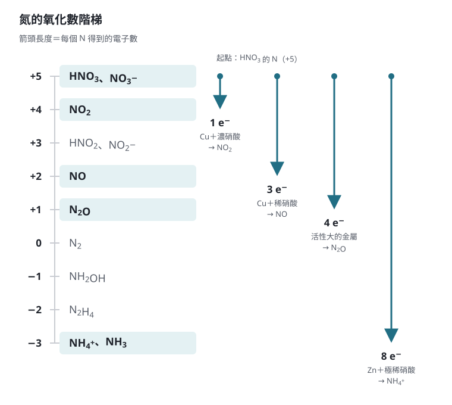
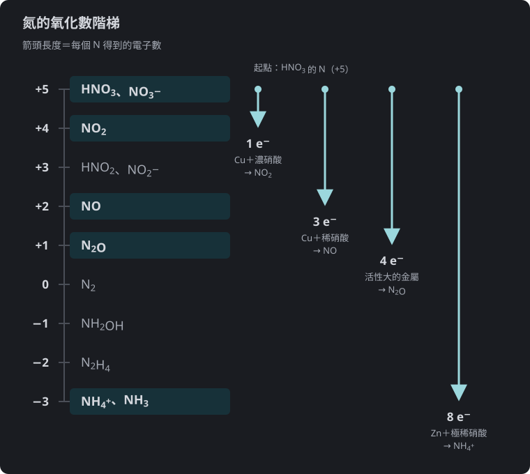

$$\require{physics}$$

<link rel="stylesheet" href="/assets/css/posts-custom.css">

> 《平衡化學反應式難題》系列：[第一篇]() ｜ **第二篇** ｜ [第三篇]()

---

[第一篇]()用代數法平衡

$$\ce{Cu2S + HNO3 -> Cu(NO3)2 + H2SO4 + NO + H2O}$$

列了五條守恆式、解了一輪分數，才得到 $3 : 22 : 6 : 3 : 10 : 8$。

這篇要做的是：**用氧化數一眼看出 $\ce{Cu2S}$ 和 $\ce{NO}$ 的比是 $3 : 10$**，剩下的係數就只是記帳。

> 氧化還原的系統介紹，各版本教材放的位置不同，不一定在你這一冊的段考範圍內。但這裡只用到「算氧化數」這一個工具，學一次就能拿來平衡反應式。
{: .prompt-info }

---

## 氧化數：給每個原子記帳

氧化數（oxidation number）是一種記帳方式：假設化合物中的每一根鍵都完全離子化，電子全歸給電負度較大的原子，這時每個原子「看起來」帶的電荷就是它的氧化數。

常用規則：

| 規則 | 例 |
|---|---|
| 元素態物質中的原子為 0 | $\ce{Cu}$、$\ce{O2}$、$\ce{N2}$、$\ce{P4}$ |
| 單原子離子 ＝ 離子電荷 | $\ce{Fe^3+}$ 為 $+3$，$\ce{Cl-}$ 為 $-1$ |
| 化合物中 F 為 $-1$；1A 族金屬 $+1$、2A 族 $+2$ | $\ce{NaCl}$ 的 Na 為 $+1$ |
| H 通常為 $+1$（金屬氫化物中為 $-1$） | $\ce{NaH}$ 的 H 為 $-1$ |
| O 通常為 $-2$（過氧化物中為 $-1$） | $\ce{H2O2}$ 的 O 為 $-1$ |
| 氧化數總和 ＝ 該物質的電荷 | $\ce{SO4^2-}$：$x + 4(-2) = -2$，S 為 $+6$ |

**氧化數上升＝失去電子＝被氧化；氧化數下降＝得到電子＝被還原。**一個反應中，失去的電子總數一定等於得到的電子總數，這就是平衡的新方程式。

---

## 電子得失法的步驟

1. 標出**氧化數有改變**的元素。
2. 以「**一個化學式**」為單位，算出失去或得到幾個電子（化學式裡有兩個同種原子要乘 2）。
3. 取最小公倍數，讓失去的電子數＝得到的電子數，定出這兩種物質的係數。
4. 其餘物質（旁觀離子、$\ce{H2O}$）用原子守恆補齊，**最後用 O 驗算**。

### 例 1：硫化亞銅溶於硝酸，再做一次

$\ce{Cu2S}$ 中 S 為 $-2$，所以 Cu 為 $+1$。反應後 Cu 成為 $+2$，S 成為 $\ce{H2SO4}$ 中的 $+6$：

$$
\begin{aligned}
\ce{Cu}&:\ +1 \to +2,\quad \text{2 個 Cu 共失 } 2e^-\\
\ce{S}&:\ -2 \to +6,\quad \text{失 } 8e^-\\
\text{每個 } \ce{Cu2S}&\ \text{共失 } 10e^-
\end{aligned}
$$

N 從 $\ce{HNO3}$ 的 $+5$ 變成 $\ce{NO}$ 的 $+2$，每個得 $3e^-$。

$10$ 與 $3$ 的最小公倍數是 $30$：

$$3\,\ce{Cu2S}\ (\text{失 } 30e^-)\quad\text{對}\quad 10\,\ce{NO}\ (\text{得 } 30e^-)$$

接著記帳：Cu 守恆得 $6\,\ce{Cu(NO3)2}$，S 守恆得 $3\,\ce{H2SO4}$；N 守恆，硝酸要 $6 \times 2 + 10 = 22$ 個；H 守恆，$22 = 3 \times 2 + 2w$，水 $w = 8$。

$$\ce{3Cu2S + 22HNO3 -> 6Cu(NO3)2 + 3H2SO4 + 10NO + 8H2O}$$

O 驗算：左 $66$，右 $36 + 12 + 10 + 8 = 66$。

和第一篇相比，五元聯立方程式被壓縮成「$10$ 對 $3$」這一步。

> **常見錯誤**：只算 S 的電子，忘了 Cu 也被氧化。$\ce{Cu2S}$ 裡**兩種元素都失電子**，要加總。
{: .prompt-warning }

### 例 2：用電子得失看龍騰習題第 3 題

第一篇的例 1 用原子收支推出 X 是 $\ce{NO}$。改用電子：$3$ 個 $\ce{Fe^2+}$ 變成 $\ce{Fe^3+}$，共失 $3e^-$；只有 $1$ 個 $\ce{KNO3}$ 可以接收，所以 N 得 $3e^-$，從 $+5$ 降到 $+2$。氧化數 $+2$ 的氮氧化物就是 $\ce{NO}$。

兩種方法得到相同答案；電子得失這條路更快，原子收支那條路不需要氧化還原的知識。

---

## 氮的氧化數階梯

氮是高中化學裡氧化數變化最多的元素，從 $-3$ 到 $+5$ 都有常見物質：

| 氧化數 | 物質 |
|---|---|
| $-3$ | $\ce{NH3}$、$\ce{NH4+}$ |
| $-2$ | $\ce{N2H4}$（聯胺） |
| $-1$ | $\ce{NH2OH}$（羥胺） |
| $0$ | $\ce{N2}$ |
| $+1$ | $\ce{N2O}$ |
| $+2$ | $\ce{NO}$ |
| $+3$ | $\ce{HNO2}$、$\ce{NO2-}$、$\ce{N2O3}$ |
| $+4$ | $\ce{NO2}$、$\ce{N2O4}$ |
| $+5$ | $\ce{HNO3}$、$\ce{NO3-}$、$\ce{N2O5}$ |

硝酸當氧化劑時，N 從 $+5$ 往下走。走多遠由反應條件決定（金屬活性、硝酸濃度），不是由平衡決定：

{: .light w="760" h="680" }
{: .dark w="760" h="680" }

**圖 1：** 硝酸中的 N 從 $+5$ 出發，被還原得越深，每個 N 得到的電子越多：到 $\ce{NO2}$ 得 1 個、到 $\ce{NO}$ 得 3 個、到 $\ce{N2O}$ 得 4 個、到 $\ce{NH4+}$ 得 8 個。
{: .fig-caption }

| 反應 | N 的變化 | 每個 N 得到的電子 |
|---|---|---|
| $\ce{Cu}$ ＋ 濃硝酸 → $\ce{NO2}$ | $+5 \to +4$ | 1 |
| $\ce{Cu}$ ＋ 稀硝酸 → $\ce{NO}$ | $+5 \to +2$ | 3 |
| 活性較大的金屬 ＋ 稀硝酸 → $\ce{N2O}$ | $+5 \to +1$ | 4 |
| $\ce{Zn}$ ＋ 極稀硝酸 → $\ce{NH4+}$ | $+5 \to -3$ | 8 |

第一列和第二列就是第一篇的 $1:4$ 與 $3:8$。用電子得失看：Cu 失 $2e^-$；濃硝酸每個 N 只得 $1e^-$，所以 $1$ 個 Cu 對 $2$ 個 $\ce{NO2}$；稀硝酸每個 N 得 $3e^-$，所以 $3$ 個 Cu 對 $2$ 個 $\ce{NO}$。

### 例 3：鋅與極稀硝酸——一個產物裡有兩種氧化數

$$\ce{Zn + HNO3 -> Zn(NO3)2 + NH4NO3 + H2O}$$

Zn 失 $2e^-$；N 從 $+5$ 到 $\ce{NH4+}$ 的 $-3$，得 $8e^-$。所以 $4\,\ce{Zn}$ 對 $1\,\ce{NH4+}$。

N 的記帳要小心：$\ce{NH4NO3}$ **有兩個 N**，一個是 $\ce{NH4+}$ 的 $-3$，一個是 $\ce{NO3-}$ 的 $+5$（沒有變）。

$$\text{N 總數} = \underbrace{4 \times 2}_{\ce{Zn(NO3)2}} + \underbrace{1}_{\ce{NH4+}} + \underbrace{1}_{\ce{NH4NO3}\text{ 的 } \ce{NO3-}} = 10$$

H 守恆：$10 = 4 + 2w$，$w = 3$。

$$\ce{4Zn + 10HNO3 -> 4Zn(NO3)2 + NH4NO3 + 3H2O}$$

O 驗算：左 $30$，右 $24 + 3 + 3 = 30$。

> **陷阱**：若把 $\ce{NH4NO3}$ 當成一個整體算「平均氧化數」，兩個 N 平均是 $+1$，會完全算錯。**氧化數要按離子分開算**，$\ce{NH4+}$ 和 $\ce{NO3-}$ 各自處理。
{: .prompt-warning }

### 例 4：硝酸銨分解——自己氧化自己

硝酸銨本身同時含有 $-3$ 和 $+5$ 的 N，加熱時可以互相反應。溫和加熱生成笑氣：

$$\ce{NH4NO3 -> N2O + 2H2O}$$

$-3 \to +1$ 失 $4e^-$，$+5 \to +1$ 得 $4e^-$，剛好 $1:1$。

題目也常出另一種分解方式，生成 $\ce{N2}$ 與 $\ce{HNO3}$：

$$\ce{NH4NO3 -> N2 + HNO3 + H2O}$$

這次 $\ce{NH4+}$ 的 N 從 $-3 \to 0$ 失 $3e^-$；被還原的 $\ce{NO3-}$ 從 $+5 \to 0$ 得 $5e^-$。電子守恆要求

$$5 \text{ 個 } \ce{NH4+}\ (\text{失 } 15e^-) \quad\text{對}\quad 3 \text{ 個 } \ce{NO3-}\ (\text{得 } 15e^-)$$

但 $5$ 份 $\ce{NH4NO3}$ 帶來 $5$ 個 $\ce{NO3-}$，只有 $3$ 個被還原，**剩下 $2$ 個成為 $\ce{HNO3}$**。$\ce{N2}$ 有 $(5 + 3)/2 = 4$ 份；H 守恆 $20 = 2 + 2w$，$w = 9$：

$$\ce{5NH4NO3 -> 4N2 + 2HNO3 + 9H2O}$$

O 驗算：左 $15$，右 $6 + 9 = 15$。

這題的關鍵和第一篇的「銅與稀硝酸」一樣：**同一種原子團，有一部分參與反應、一部分只是路過。**

### 例 5：重鉻酸銨火山實驗

龍騰版選修化學 I 第一章的素養題描述了一種橘色固體：莫耳質量 $252\ \text{g/mol}$，受熱分解後留下綠色的 $\ce{Cr2O3}$，並放出空氣中最多的氣體（$\ce{N2}$）與能使白色硫酸銅變藍的物質（$\ce{H2O}$）。這是「火山實驗」用的重鉻酸銨 $\ce{(NH4)2Cr2O7}$。

驗算莫耳質量：$2 \times 18.0 + 2 \times 52.0 + 7 \times 16.0 = 252$。

$$\ce{(NH4)2Cr2O7 -> Cr2O3 + N2 + H2O}$$

- Cr：$+6 \to +3$，兩個 Cr 共得 $6e^-$
- N：$-3 \to 0$，兩個 N 共失 $6e^-$

同一個化學式內就已經電子平衡，所以 $\ce{(NH4)2Cr2O7}$、$\ce{Cr2O3}$、$\ce{N2}$ 都是 $1$，H 守恆得 $4\,\ce{H2O}$：

$$\ce{(NH4)2Cr2O7 -> Cr2O3 + N2 + 4H2O}$$

這正對應題目給的「$\ce{N2}$ 與水蒸氣體積比 $1:4$」。氧化劑（$\ce{Cr2O7^2-}$）和還原劑（$\ce{NH4+}$）在同一個化合物裡，稱為**分子內氧化還原**（intramolecular redox）。它和下一節的自身氧化還原不同：這裡被氧化的是 N、被還原的是 Cr，是兩種不同的元素。

### 例 6：綠礬分解，用電子驗算

第一篇用「拆氧化物」平衡了

$$\ce{2FeSO4*7H2O -> Fe2O3 + SO2 + SO3 + 14H2O}$$

用氧化數驗算：Fe 從 $+2 \to +3$，每個失 $1e^-$；S 從 $+6 \to +4$（成為 $\ce{SO2}$），每個得 $2e^-$。所以 $2$ 個 Fe 對 $1$ 個 $\ce{SO2}$，另一個 S 保持 $+6$ 成為 $\ce{SO3}$。兩種方法一致。

---

## 進階：分數氧化數與一次失好幾種電子

### 例 7：四氧化三鐵溶於稀硝酸

$$\ce{Fe3O4 + HNO3 -> Fe(NO3)3 + NO + H2O}$$

$\ce{Fe3O4}$ 中 Fe 的**平均**氧化數是 $+\tfrac{8}{3}$（實際上是一個 $\ce{Fe^2+}$ 加兩個 $\ce{Fe^3+}$）。全部變成 $+3$：

$$3 \times (+3) - (+8) = 1 \quad\Longrightarrow\quad \text{每個 } \ce{Fe3O4} \text{ 只失 } 1e^-$$

N 得 $3e^-$，所以 $3\,\ce{Fe3O4}$ 對 $1\,\ce{NO}$。Fe 守恆得 $9\,\ce{Fe(NO3)3}$；硝酸 $27 + 1 = 28$；H 守恆得 $14\,\ce{H2O}$：

$$\ce{3Fe3O4 + 28HNO3 -> 9Fe(NO3)3 + NO + 14H2O}$$

O 驗算：左 $12 + 84 = 96$，右 $81 + 1 + 14 = 96$。

28 份硝酸中只有 1 份被還原。**用「整個化學式的總氧化數變化」來算**，就不必在意平均氧化數是不是整數。

### 例 8：硫化砷溶於硝酸（魔王題）

$$\ce{As2S3 + HNO3 + H2O -> H3AsO4 + H2SO4 + NO}$$

$\ce{As2S3}$ 中 As 為 $+3$、S 為 $-2$。

$$
\begin{aligned}
\ce{As}&:\ +3 \to +5,\quad 2 \times 2 = 4e^-\\
\ce{S}&:\ -2 \to +6,\quad 3 \times 8 = 24e^-\\
\text{每個 } \ce{As2S3}&\ \text{共失 } 28e^-
\end{aligned}
$$

N 得 $3e^-$。最小公倍數 $84$：$3\,\ce{As2S3}$ 對 $28\,\ce{NO}$。接著 As 守恆 $6\,\ce{H3AsO4}$，S 守恆 $9\,\ce{H2SO4}$，N 守恆 $28\,\ce{HNO3}$，最後 H 守恆定出水：

$$28 + 2w = 18 + 18 \quad\Longrightarrow\quad w = 4$$

$$\ce{3As2S3 + 28HNO3 + 4H2O -> 6H3AsO4 + 9H2SO4 + 28NO}$$

O 驗算：左 $84 + 4 = 88$，右 $24 + 36 + 28 = 88$。

注意這題的**水在反應物那邊**。H、O 留到最後才補，補出來是哪一邊就是哪一邊，不用事先猜。

---

## 同一種元素同時升與降：自身氧化還原

有時同一種物質的同一種元素，一部分被氧化、一部分被還原，稱為**自身氧化還原**（disproportionation）。

### 例 9：白磷與鹼

$$\ce{P4 + NaOH + H2O -> NaH2PO2 + PH3}$$

P 從 $0$ 變成 $\ce{H2PO2-}$ 的 $+1$（失 $1e^-$），也變成 $\ce{PH3}$ 的 $-3$（得 $3e^-$）。所以 $3$ 個 P 往上、$1$ 個 P 往下，剛好一個 $\ce{P4}$：

$$\ce{P4 + 3NaOH + 3H2O -> 3NaH2PO2 + PH3}$$

### 例 10：硫代硫酸鈉與鹽酸

$$\ce{Na2S2O3 + 2HCl -> 2NaCl + S + SO2 + H2O}$$

$\ce{S2O3^2-}$ 中 S 的平均氧化數為 $+2$，一個降到 $0$（$\ce{S}$）、一個升到 $+4$（$\ce{SO2}$），得失各 $2e^-$。段考常把這條反應式的係數拆成選項，問哪些關係式成立。先把式子平衡好，再逐一檢查選項，就不容易被干擾。

---

## 總結

| 步驟 | 動作 | 易錯點 |
|---|---|---|
| 1 | 標出氧化數有變化的元素 | 同一個化學式內可能有兩種元素都變（$\ce{Cu2S}$、$\ce{As2S3}$） |
| 2 | 以一個化學式為單位算電子 | 下標要乘進去；平均氧化數可以是分數 |
| 3 | 失去＝得到，定出關鍵比例 | 同一種原子團可能只有一部分參與反應 |
| 4 | 旁觀離子 → H → 用 O 驗算 | $\ce{H2O}$ 可能出現在反應物 |

- 氧化數是記帳工具，**含多種離子的化合物要分開算**（$\ce{NH4NO3}$）。
- 電子守恆一次給出「氧化劑對還原劑」的比例，取代代數法中最難解的那幾條式子。
- 產物是什麼、氮要被還原到幾價，是化學條件決定的；電子守恆只負責算係數。

---

## 延伸閱讀

- [第一篇：觀察法、原子團與代數法]()
- [第三篇：矩陣、高斯消去法與「答案不唯一」的反應式]()——當一個反應同時有兩種氧化劑時，電子守恆只剩一條式子，會發生什麼事？
