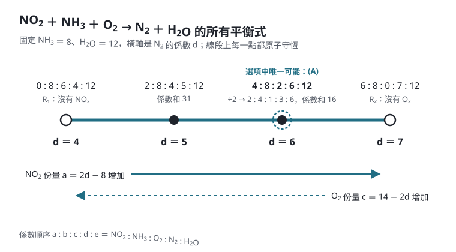
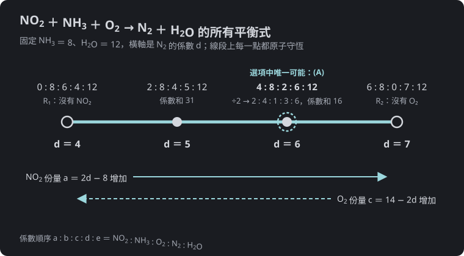

$$\require{physics}$$

<link rel="stylesheet" href="/assets/css/posts-custom.css">

> 《平衡化學反應式難題》系列：[第一篇]() ｜ [第二篇]() ｜ **第三篇**

---

先看一道段考題：

> **衛理女中 115 學年度第 1 學期第 1 次期中考，高二化學第 7 題（改寫）**：反應式
>
> $$\ce{NO2 + NH3 + O2 -> N2 + H2O}$$
>
> 平衡後，各係數為最簡單整數比時，係數和為多少？（A）16（B）18（C）20（D）22（E）24

試著平衡，會得到 $\ce{2NO2 + 4NH3 + O2 -> 3N2 + 6H2O}$，係數和 $16$。但下面這條也完全平衡：

$$\ce{2NO2 + 8NH3 + 4O2 -> 5N2 + 12H2O}$$

驗算：N 左 $2 + 8 = 10$、右 $10$；H 左 $24$、右 $24$；O 左 $4 + 8 = 12$、右 $12$。係數已經互質，也是「最簡單整數比」，係數和卻是 $31$。

同一條反應式有兩組不同的最簡單整數比？這篇要用線性代數說清楚：**什麼時候平衡的答案唯一，什麼時候不唯一，不唯一時又該怎麼辦。**

---

## 平衡化學反應式＝齊次線性聯立方程式

[第一篇]()的代數法，是對每一種元素寫一條守恆式。把**生成物的係數移到左邊**，每條式子都長成「某些係數的組合 $= 0$」：

$$x_1\,\ce{Cu} + x_2\,\ce{HNO3} \ce{->} x_3\,\ce{Cu(NO3)2} + x_4\,\ce{NO} + x_5\,\ce{H2O}$$

$$
\begin{aligned}
\text{Cu}&:\ x_1 - x_3 = 0\\
\text{H}&:\ x_2 - 2x_5 = 0\\
\text{N}&:\ x_2 - 2x_3 - x_4 = 0\\
\text{O}&:\ 3x_2 - 6x_3 - x_4 - x_5 = 0
\end{aligned}
$$

右邊全是 $0$ 的線性聯立方程式稱為**齊次**（homogeneous）。寫成矩陣：每一**列**是一種元素，每一**行**是一種物質，生成物那幾行帶負號。

$$
A = \begin{bmatrix}
1 & 0 & -1 & 0 & 0\\
0 & 1 & 0 & 0 & -2\\
0 & 1 & -2 & -1 & 0\\
0 & 3 & -6 & -1 & -1
\end{bmatrix},
\qquad A\vb{x} = \vb{0}
$$

這個矩陣就是反應式的「原子組成表」：第 3 行 $(1, 0, 2, 6)$ 取負號，正是 $\ce{Cu(NO3)2}$ 含 1 個 Cu、0 個 H、2 個 N、6 個 O。

### 高斯消去

對 $A$ 做列運算（第 3 列減第 2 列、第 4 列減 3 倍第 2 列，再把新的第 4 列減 3 倍新的第 3 列）：

$$
\begin{bmatrix}
1 & 0 & -1 & 0 & 0\\
0 & 1 & 0 & 0 & -2\\
0 & 0 & -2 & -1 & 2\\
0 & 0 & 0 & 2 & -1
\end{bmatrix}
$$

四個領導係數分別在第 1、2、3、4 行，**只有 $x_5$ 是自由變數**。令 $x_5 = t$，由下往上代回：

$$x_4 = \frac{t}{2},\qquad x_3 = \frac{3t}{4},\qquad x_2 = 2t,\qquad x_1 = \frac{3t}{4}$$

取 $t = 4$ 消去分母：$(x_1, \dots, x_5) = (3, 8, 3, 2, 4)$，正是

$$\ce{3Cu + 8HNO3 -> 3Cu(NO3)2 + 2NO + 4H2O}$$

這個過程和[線性聯立方程式與高斯消去法]()裡解一般聯立方程式完全相同；高二下學期數學（第四冊）的矩陣單元也會教到。

---

## 關鍵數字：自由變數有幾個？

齊次聯立方程式一定有解 $\vb{x} = \vb{0}$（什麼都不放），我們要的是非零解。設反應式有 $n$ 種物質，係數矩陣中**真正獨立的守恆式**有 $r$ 條（$r$ 是矩陣的秩，rank）：

$$\text{自由變數個數} = n - r$$

| $n - r$ | 意義 | 例 |
|---|---|---|
| $0$ | 只有全零解：這些物質**不可能**組成一條平衡的反應式 | $\ce{CO -> CO2}$（沒有其他物質提供 O） |
| $1$ | 所有解都是同一組比例的倍數：**最簡單整數比唯一** | 絕大多數課本與考題 |
| $2$ 以上 | 有兩組以上**彼此獨立**的比例，可以任意混合 | 本篇開頭那一題 |

注意 $r$ 不一定等於元素種數。有時某條守恆式可以由其他幾條推出來（例如離子反應式的電荷守恆，有時會和元素守恆重複），它就不算「獨立」的一條。高斯消去法會自動處理：消到全零的那一列，就是多餘的式子。

平常說「平衡後最簡單整數比」，其實默認了 $n - r = 1$。

---

## 回到段考題：兩條反應疊在一起

$$a\,\ce{NO2} + b\,\ce{NH3} + c\,\ce{O2} \ce{->} d\,\ce{N2} + e\,\ce{H2O}$$

只有 N、H、O 三種元素，卻有 5 種物質：

$$
\begin{bmatrix}
1 & 1 & 0 & -2 & 0\\
0 & 3 & 0 & 0 & -2\\
2 & 0 & 2 & 0 & -1
\end{bmatrix}
\begin{bmatrix} a\\ b\\ c\\ d\\ e \end{bmatrix}
= \vb{0}
$$

消去後秩為 $3$，自由變數有 $5 - 3 = 2$ 個。令 $d$、$e$ 自由，解出

$$b = \frac{2e}{3},\qquad c = \frac{7e - 12d}{6},\qquad a = 2d - \frac{2e}{3}$$

這是一個**兩個參數**的解。換個角度看，所有解都是下面兩條反應式的組合：

$$
\begin{aligned}
R_1&:\quad \ce{4NH3 + 3O2 -> 2N2 + 6H2O}\\
R_2&:\quad \ce{6NO2 + 8NH3 -> 7N2 + 12H2O}
\end{aligned}
$$

$R_1$ 是氨被氧氣氧化，$R_2$ 是氨被二氧化氮氧化，兩者都各自平衡。把它們用任意正數比例相加，得到的都是「$\ce{NO2 + NH3 + O2 -> N2 + H2O}$」的平衡式：

- $R_1 + R_2$，再除以 3：$\ce{2NO2 + 4NH3 + O2 -> 3N2 + 6H2O}$，係數和 $16$
- $4R_1 + R_2$，再除以 3：$\ce{2NO2 + 8NH3 + 4O2 -> 5N2 + 12H2O}$，係數和 $31$

{: .light w="760" h="420" }
{: .dark w="760" h="420" }

**圖 1：** 固定 $\ce{NH3}$ 與 $\ce{H2O}$ 的係數後，所有平衡式落在同一條線段上。左端 $R_1$ 只用 $\ce{O2}$、右端 $R_2$ 只用 $\ce{NO2}$；往右走，$\ce{NO2}$ 分擔得越多、$\ce{O2}$ 越少。線段內部的每一點都同時含有五種物質，所以都符合題意。
{: .fig-caption }

**原子守恆只能告訴你「兩種氧化劑合計」要接收多少電子，不能告訴你 $\ce{NO2}$ 和 $\ce{O2}$ 各分擔多少。**用[第二篇]()的電子得失來看最清楚：$\ce{NH3}$ 的 N 從 $-3 \to 0$ 失 $3e^-$；$\ce{NO2}$ 的 N 從 $+4 \to 0$ 得 $4e^-$；每個 $\ce{O2}$ 得 $4e^-$。電子守恆只給一條式子

$$3b = 4a + 4c$$

卻有 $a$、$c$ 兩個氧化劑的係數要分配。

### 那這題選什麼？

要五種物質的係數都是正整數，由上面的通解可得 $\dfrac{d}{e}$ 必須介於 $\dfrac13$ 與 $\dfrac{7}{12}$ 之間。逐一列出互質的正整數解，係數和由小到大是

$$16,\ 31,\ 46,\ 47,\ 49,\ \dots$$

五個選項中只有 $16$ 可能出現，而且 $16$ 是**所有可能答案中係數和最小的**，所以依選項推得應選 **（A）**。（官方解答我們沒有看到，這裡是從選項推論的結果。）

但嚴格來說，「最簡單整數比」在這題並不能唯一決定答案。題目若要沒有爭議，需要多給一個條件，例如「$\ce{NO2}$ 與 $\ce{O2}$ 的莫耳數比為 $2:1$」，或直接給定某一個係數。這類反應在選擇性催化還原（SCR）脫硝的資料中也看得到：$\ce{6NO2 + 8NH3 -> 7N2 + 12H2O}$（$R_2$）與 $\ce{2NO2 + 4NH3 + O2 -> 3N2 + 6H2O}$（上面的 $16$）都被列為 SCR 反應，氨與氧氣直接反應的 $\ce{4NH3 + 3O2 -> 2N2 + 6H2O}$（$R_1$）則是需要避免的副反應（見 [DieselNet 的 SCR 整理](https://dieselnet.com/tech/cat_scr.php)）。要注意氨的氧化也可能得到 $\ce{N2O}$ 或 $\ce{NO}$，$R_1$ 只是其中一條路徑。實際比例由反應條件與動力學決定，不是由平衡決定。

> **怎麼在考場上察覺？** 數一數：物質種數減去元素種數（離子反應再減掉電荷那一條）。如果差值大於 1，而且有**兩種以上的氧化劑或兩種以上的還原劑**，就要懷疑答案不唯一，回頭找題目有沒有給額外的比例條件。
{: .prompt-tip }

---

## 另一個常見情形：銅溶於「不濃不稀」的硝酸

第一篇提到，濃硝酸生成 $\ce{NO2}$、稀硝酸生成 $\ce{NO}$。如果硝酸濃度介於中間，兩種氣體都有：

$$\ce{Cu + HNO3 -> Cu(NO3)2 + NO + NO2 + H2O}$$

4 種元素、6 種物質，自由變數 $6 - 4 = 2$ 個。所有解都是濃、稀兩條反應式的組合：

$$
\begin{aligned}
\text{濃}&:\quad \ce{Cu + 4HNO3 -> Cu(NO3)2 + 2NO2 + 2H2O}\\
\text{稀}&:\quad \ce{3Cu + 8HNO3 -> 3Cu(NO3)2 + 2NO + 4H2O}
\end{aligned}
$$

所以這類題目一定會附上條件，例如「生成的 $\ce{NO}$ 與 $\ce{NO2}$ 體積比為 $1:1$」。兩條各取 1 份相加，$\ce{NO}$、$\ce{NO2}$ 都是 2，再除以 2：

$$\ce{2Cu + 6HNO3 -> 2Cu(NO3)2 + NO + NO2 + 3H2O}$$

驗算電子：2 個 Cu 失 $4e^-$；$\ce{NO}$ 得 $3e^-$、$\ce{NO2}$ 得 $1e^-$，合計 $4e^-$。

**額外的比例條件，就是補上缺少的那一條方程式**，讓自由變數回到 1 個。

### 化學也會告訴你答案：過錳酸鉀與雙氧水

$$\ce{KMnO4 + H2O2 + H2SO4 -> K2SO4 + MnSO4 + O2 + H2O}$$

這是課本常見的反應，自由變數卻也是 2 個，因為雙氧水自己分解 $\ce{2H2O2 -> 2H2O + O2}$ 也是一條平衡式，可以任意疊加進去：

$$\ce{2KMnO4} + (5+2k)\,\ce{H2O2} + \ce{3H2SO4} \ce{->} \ce{K2SO4} + \ce{2MnSO4} + (5+k)\,\ce{O2} + (8+2k)\,\ce{H2O}$$

$k = 0, 1, 2, \dots$ 全都原子守恆。課本採用 $k = 0$：

$$\ce{2KMnO4 + 5H2O2 + 3H2SO4 -> K2SO4 + 2MnSO4 + 5O2 + 8H2O}$$

這不是數學選出來的，而是化學：$\ce{MnO4-}$ 得到的電子全部來自 $\ce{H2O2}$ 被氧化（以 $^{18}$O 富集水做的研究，摘要指出放出的氧完全來自過氧化氫，見 [1951 年〈Zur Frage der Herkunft des Sauerstoffs bei der Oxydation von Wasserstoffperoxyd durch Permanganat〉](https://link.springer.com/article/10.1007/BF02138996)），所以要求 $\ce{MnO4-}$ 得 $5e^-$ 與 $\ce{H2O2}$ 失 $2e^-$ 精確配對，也就是 $2:5$。

> 數學負責告訴你「解有幾個自由度」；**多出來的自由度，要靠化學機制或題目條件來決定。**
{: .prompt-info }

---

## 魔王題：亞鐵氰化鉀與過錳酸鉀

最後挑戰一條有 9 種物質的反應式：

$$\ce{K4Fe(CN)6 + KMnO4 + H2SO4 -> KHSO4 + Fe2(SO4)3 + MnSO4 + HNO3 + CO2 + H2O}$$

設係數依序為 $x_1, x_2, \dots, x_9$。8 種元素（K、Fe、C、N、Mn、S、O、H），係數矩陣是 $8 \times 9$：

$$
\begin{array}{c}
\text{K}\\ \text{Fe}\\ \text{C}\\ \text{N}\\ \text{Mn}\\ \text{S}\\ \text{O}\\ \text{H}
\end{array}
\begin{bmatrix}
4 & 1 & 0 & -1 & 0 & 0 & 0 & 0 & 0\\
1 & 0 & 0 & 0 & -2 & 0 & 0 & 0 & 0\\
6 & 0 & 0 & 0 & 0 & 0 & 0 & -1 & 0\\
6 & 0 & 0 & 0 & 0 & 0 & -1 & 0 & 0\\
0 & 1 & 0 & 0 & 0 & -1 & 0 & 0 & 0\\
0 & 0 & 1 & -1 & -3 & -1 & 0 & 0 & 0\\
0 & 4 & 4 & -4 & -12 & -4 & -3 & -2 & -1\\
0 & 0 & 2 & -1 & 0 & 0 & -1 & 0 & -2
\end{bmatrix}
$$

完整做高斯消去當然可以，但手算時有更聰明的消去順序：**先保留 $x_1$、$x_2$ 當參數，用簡單的式子把其他未知數全部表示出來，最後讓 O 決定 $x_1 : x_2$。**

$$
\begin{aligned}
\text{Fe}&:\ x_5 = \tfrac12 x_1\\
\text{C}&:\ x_8 = 6x_1\\
\text{N}&:\ x_7 = 6x_1\\
\text{Mn}&:\ x_6 = x_2\\
\text{K}&:\ x_4 = 4x_1 + x_2\\
\text{S}&:\ x_3 = x_4 + 3x_5 + x_6 = \tfrac{11}{2}x_1 + 2x_2\\
\text{H}&:\ x_9 = \tfrac12(2x_3 - x_4 - x_7) = \tfrac12(x_1 + 3x_2)
\end{aligned}
$$

剩下 O 這一條還沒用：

$$4x_2 + 4x_3 = 4x_4 + 12x_5 + 4x_6 + 3x_7 + 2x_8 + x_9$$

把上面的結果代入，左邊是 $22x_1 + 12x_2$，右邊是 $\tfrac{105}{2}x_1 + \tfrac{19}{2}x_2$：

$$22x_1 + 12x_2 = \frac{105}{2}x_1 + \frac{19}{2}x_2 \quad\Longrightarrow\quad 5x_2 = 61x_1$$

取 $x_1 = 10$（同時消掉 $x_5$ 和 $x_9$ 的分母），$x_2 = 122$，其餘依序代回：

$$\ce{10K4Fe(CN)6 + 122KMnO4 + 299H2SO4 -> 162KHSO4 + 5Fe2(SO4)3 + 122MnSO4 + 60HNO3 + 60CO2 + 188H2O}$$

### 用電子得失驗算

$5x_2 = 61x_1$ 這個奇怪的 $61$ 是從哪裡來的？用第二篇的方法：$\ce{[Fe(CN)6]^4-}$ 中 Fe 為 $+2$，$\ce{CN-}$ 中 C 為 $+2$、N 為 $-3$。

| 元素 | 變化 | 每個 $\ce{K4Fe(CN)6}$ 失去的電子 |
|---|---|---|
| Fe | $+2 \to +3$ | $1$ |
| C | $+2 \to +4$（成 $\ce{CO2}$） | $6 \times 2 = 12$ |
| N | $-3 \to +5$（成 $\ce{HNO3}$） | $6 \times 8 = 48$ |
| 合計 | | $61$ |

Mn 從 $+7 \to +2$，每個 $\ce{KMnO4}$ 得 $5e^-$。電子守恆 $61x_1 = 5x_2$，和矩陣算出來的完全一致。

這條反應式裡只有一種氧化劑（$\ce{MnO4-}$）、一種還原劑（$\ce{[Fe(CN)6]^4-}$），所以自由變數只有 1 個，答案唯一；係數再大也只是計算量的問題，不是「答案不唯一」的問題。

---

## 平衡了，不代表會發生

最後提醒一件事。$\ce{Cu + HNO3 -> Cu(NO3)2 + H2}$ 也解得出係數：

$$\ce{Cu + 2HNO3 -> Cu(NO3)2 + H2}$$

原子完全守恆，但銅和硝酸**不會**放出氫氣。原子守恆是反應能發生的必要條件，不是充分條件。哪些產物會出現，是實驗與化學原理的問題；矩陣只負責在產物確定之後，把係數算出來。

---

## 總結

| 概念 | 化學意義 |
|---|---|
| 係數矩陣 $A$ | 列＝元素（與電荷），行＝物質，生成物帶負號 |
| $A\vb{x} = \vb{0}$ | 每種元素守恆；平衡＝找非零解 |
| 高斯消去 | 代數法的系統化版本，自動找出多餘的守恆式 |
| 自由變數個數 $n - r$ | $1$：比例唯一；$\ge 2$：有多條獨立反應疊加 |
| 多出來的自由度 | 由題目條件（氣體比例）或化學機制（電子從哪裡來）決定 |

- 「最簡單整數比」只有在自由變數恰好 1 個時才唯一。
- 有兩種以上的氧化劑（或還原劑）時，要特別檢查題目是否給了額外條件。
- 大反應式手算時，先用簡單元素把未知數表示成少數幾個參數，最後用 O（或 H）定比例；再用電子得失驗算。

---

## 延伸閱讀

- [第一篇：觀察法、原子團與代數法]()
- [第二篇：用氧化數算電子得失]()
- [線性聯立方程式與高斯消去法：從增廣矩陣到解空間]()
