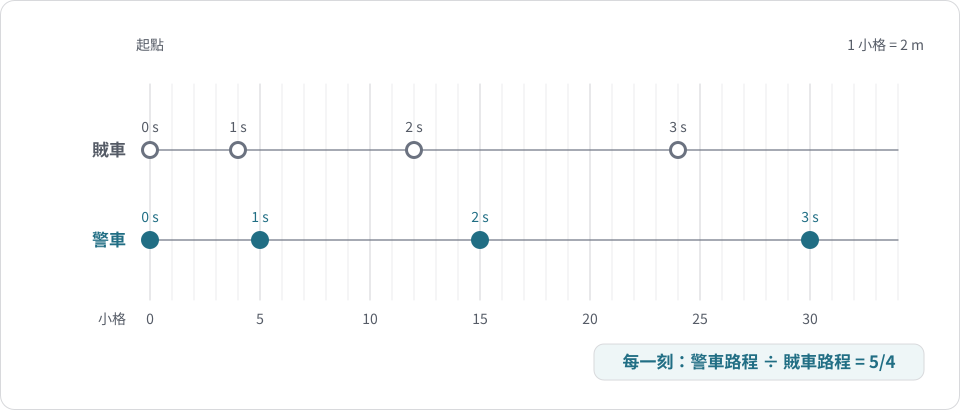
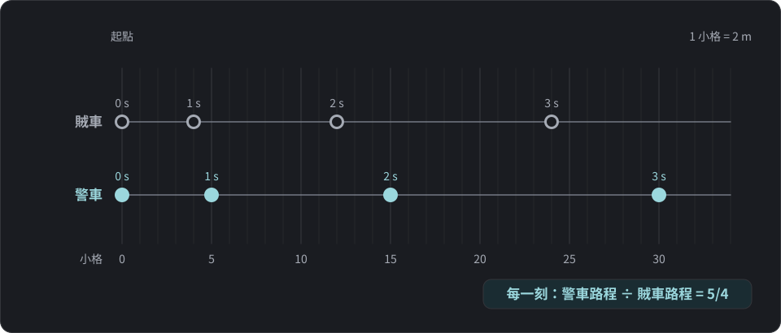
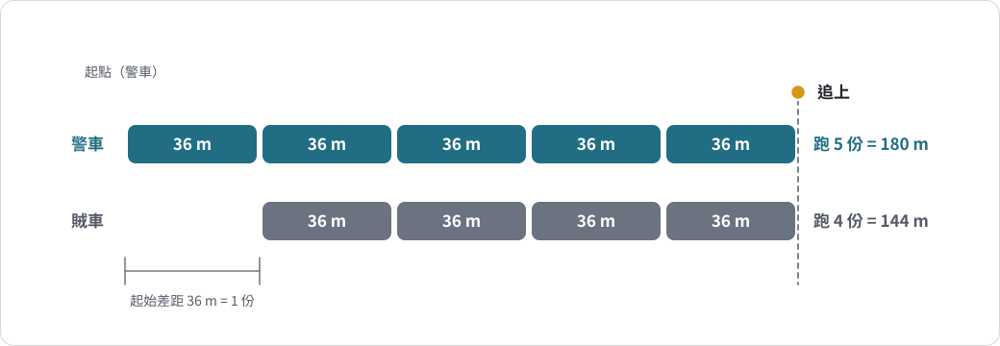
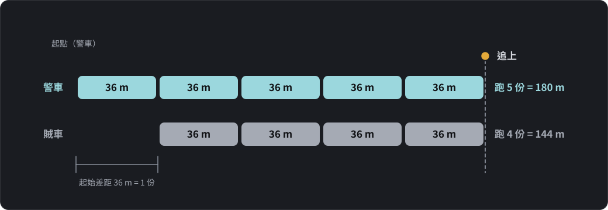
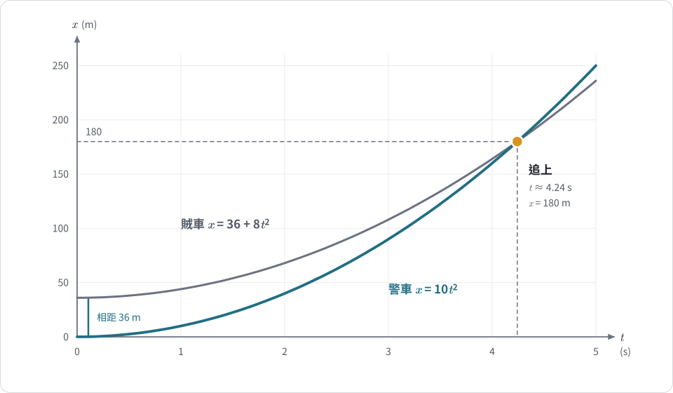
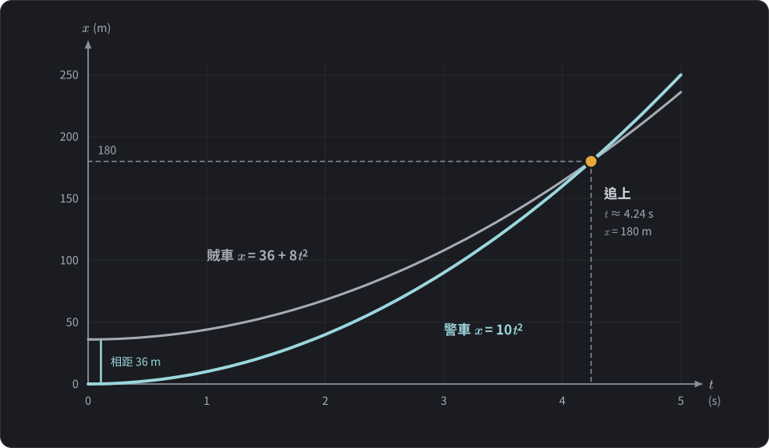
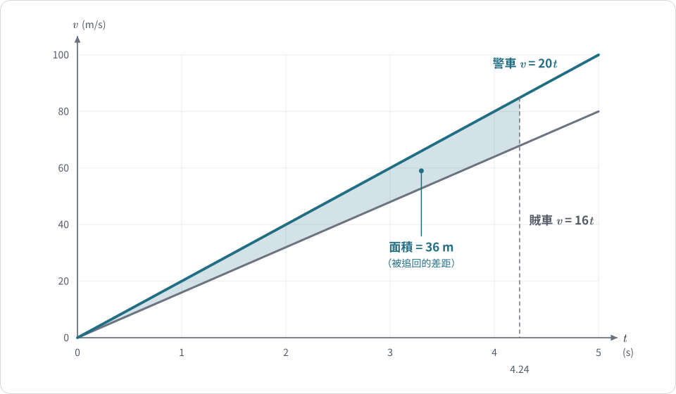
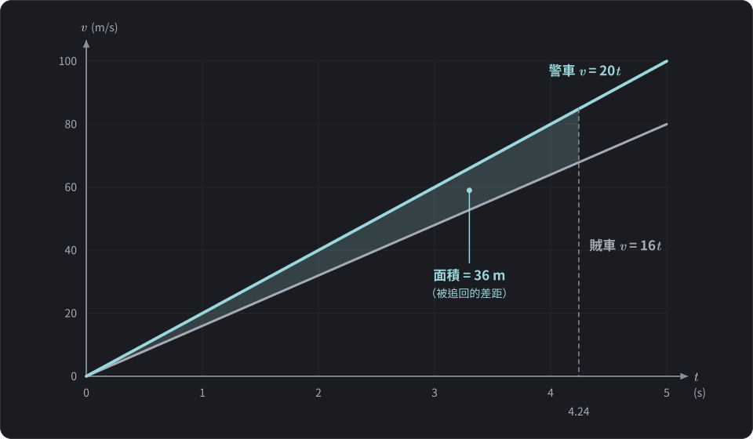

$$\require{physics}$$

<link rel="stylesheet" href="/assets/css/posts-custom.css">

這是一題國中理化段考的追趕問題。題目大意是：

> 警察在 36 公尺外發現通緝犯的賊車，開始沿直線加速追趕；同時賊車也沿同一直線加速逃離。兩車都**從靜止開始加速**。題目給了兩車開始加速後前 3 秒的軌跡圖，每個點之間間隔 1 秒，圖中 1 格代表 2 公尺。問：警車從開始加速到追上賊車，要移動多少距離？
>
> (A) 180 m　(B) 150 m　(C) 120 m　(D) 80 m

**答案是 (A) 180 m。**

最快的解法完全不用公式，只要看出一個比例。這篇先講這個速解，再用三種正規方法驗證，最後談這題藏著的洞見：答案為什麼跟「1 格是幾公尺」無關。

---

## 先讀圖：兩車每秒在哪裡

軌跡圖上的粗線之間還有細線，每一大格切成 5 小格。以起點為 0，數小格：

| 時間 | 0 s | 1 s | 2 s | 3 s |
|---|:---:|:---:|:---:|:---:|
| 警車位置（小格） | 0 | 5 | 15 | 30 |
| 賊車位置（小格） | 0 | 4 | 12 | 24 |
| 警車 ÷ 賊車 | — | 5/4 | 5/4 | 5/4 |

{: .light w="760" }
{: .dark w="760" }

**圖 1：** 依上表重畫的軌跡圖（1 小格 = 2 m）。兩列起點對齊，每個點上方標示時間；任一時刻警車距離都是賊車的 $\frac{5}{4}$ 倍。
{: .fig-caption }

最後一列是整題的關鍵：**在每一個時刻，警車跑的距離都是賊車的 $\frac{5}{4}$ 倍。**

---

## 解法一：比例速解（10 秒內解完）

既然警車跑的距離永遠是賊車的 $\frac{5}{4}$ 倍，就可以把兩車的路程想成「份數」：

- 賊車跑 4 份，警車就跑 5 份。
- 警車要追上，必須比賊車多跑起初那 36 公尺。
- 多跑的部分是 $5-4=1$ 份，所以 1 份 = 36 公尺。

追上時：

$$\text{警車路程} = 5 \times 36 = 180\ \text{m},\qquad \text{賊車路程} = 4\times 36 = 144\ \text{m}$$

驗算：$180-144=36$，剛好補上一開始的差距。✓

這個方法沒有用到加速度、時間，連「1 格 = 2 公尺」都沒用到。

{: .light w="900" }
{: .dark w="900" }

**圖 2：** 把路程切成「份」。賊車一開始領先 1 份（36 m），追上時警車跑 5 份、賊車跑 4 份，兩車在同一點相遇。
{: .fig-caption }

### 為什麼比例會一直固定？

兩車**同時**從**靜止**開始做等加速度運動，位移都是

$$x=\frac{1}{2}at^2$$

在同一個時刻 $t$，兩車的 $\frac{1}{2}t^2$ 一樣，所以位移比就等於加速度比：

$$\frac{x_{\text{警}}}{x_{\text{賊}}}=\frac{\frac{1}{2}a_{\text{警}}t^2}{\frac{1}{2}a_{\text{賊}}t^2}=\frac{a_{\text{警}}}{a_{\text{賊}}}$$

加速度不會變，所以這個比值從頭到尾都不變。比例法不是投機取巧，它就是等加速度公式的直接結果。

---

## 解法二：正規解，列兩條位置式

這是課本的標準做法：先求加速度，再列位置式，最後找「位置相同」的時刻。

**步驟 1：從圖求加速度。** 1 小格 = 2 m。看第 1 秒：

- 警車跑了 5 小格 = 10 m，代入 $x=\frac{1}{2}at^2$：$10=\frac{1}{2}a\times1^2$，警車加速度為 $20\ \text{m/s}^2$。
- 賊車跑了 4 小格 = 8 m，同理得賊車加速度為 $16\ \text{m/s}^2$。

**步驟 2：列位置式。** 以警車起點為原點，賊車一開始在前方 36 m：

$$x_{\text{警}}=\frac{1}{2}(20)t^2=10t^2$$

$$x_{\text{賊}}=36+\frac{1}{2}(16)t^2=36+8t^2$$

**步驟 3：追上就是位置相同。**

$$10t^2=36+8t^2 \quad\Rightarrow\quad 2t^2=36 \quad\Rightarrow\quad t^2=18,\ t=3\sqrt{2}\approx 4.24\ \text{s}$$

**步驟 4：求警車路程。**

$$x_{\text{警}}=10t^2=10\times18=180\ \text{m}$$

答案同樣是 180 m。這個方法比較長，但它還求出了**追上的時間**，這是比例法給不了的資訊。

{: .light w="760" }
{: .dark w="760" }

**圖 3：** 兩車的 $x$–$t$ 圖（以警車起點為原點）。賊車從 36 m 處出發，兩條曲線的交點就是「位置相同」，也就是追上。
{: .fig-caption }

---

## 解法三：相對運動，站在賊車上看

換個角度，想像你坐在賊車上看警車：

- 一開始，警車在你後方 36 m，兩車都靜止，所以相對速度是 0。
- 警車的加速度比你大 $20-16=4\ \text{m/s}^2$，這就是**相對加速度**。

在賊車上看，警車就像「從靜止出發、加速度 $4\ \text{m/s}^2$、要追 36 m」：

$$\frac{1}{2}(4)t^2=36\quad\Rightarrow\quad t^2=18$$

再回到地面算警車路程：$\frac{1}{2}(20)(18)=180$ m。

相對運動的好處是把「兩台車」化成「一台車」，追趕問題的本質是**差距從 36 m 縮到 0**。

---

## 解法四：v-t 圖面積

畫出兩車的 v-t 圖：兩條都是從原點出發的斜直線，警車那條比較陡（斜率 20），賊車那條比較緩（斜率 16）。

v-t 圖下的面積是位移，所以**兩條線之間夾的三角形面積，就是警車多跑的距離**。這個三角形底是 $t$，高是兩車速度差 $(20-16)t=4t$：

$$\frac{1}{2}\times t\times 4t=36\quad\Rightarrow\quad t^2=18$$

警車路程就是警車那條線下的三角形面積：$\frac{1}{2}\times t\times 20t=10t^2=180$ m。

{: .light w="760" }
{: .dark w="760" }

**圖 4：** 兩車的 $v$–$t$ 圖。兩條直線之間、到追上時刻為止的三角形面積是 36 m，正好是警車要補回的起始差距。
{: .fig-caption }

你會發現：解法三的「相對加速度」，在 v-t 圖上就是「兩條線斜率的差」；解法一的「5 份比 4 份」，就是兩個三角形面積的比。四種方法其實在講同一件事。

---

## 洞見一：答案只看比例，和格子大小無關

把解法二改成符號，設起始差距為 $d$。追上時兩車位置相同：

$$\frac{1}{2}a_{\text{警}}t^2=d+\frac{1}{2}a_{\text{賊}}t^2$$

解出

$$\frac{1}{2}t^2=\frac{d}{a_{\text{警}}-a_{\text{賊}}}$$

代回警車路程：

$$\boxed{x_{\text{警}}=d\cdot\frac{a_{\text{警}}}{a_{\text{警}}-a_{\text{賊}}}=\frac{d}{1-\dfrac{a_{\text{賊}}}{a_{\text{警}}}}}$$

這條式子說明：警車要跑多遠，只取決於起始差距 $d$ 和**加速度的比值**，跟加速度本身多大無關。這題比值是 $\frac{4}{5}$，所以 $x_{\text{警}}=\frac{36}{1-4/5}=180$ m。

這也回答了一個讀圖時可能卡住的問題：「1 格」到底是指大格還是小格？

| 「1 格 = 2 m」解讀為 | 警車加速度 | 賊車加速度 | 追上時間 | 警車路程 |
|---|:---:|:---:|:---:|:---:|
| 1 小格 | $20\ \text{m/s}^2$ | $16\ \text{m/s}^2$ | 約 4.24 s | **180 m** |
| 1 大格 | $4\ \text{m/s}^2$ | $3.2\ \text{m/s}^2$ | 約 9.49 s | **180 m** |

**時間**會隨解讀不同而改變，但**距離**不會。因為格子大小同時放大或縮小兩車的加速度，比值不變，所以答案不變。這也是為什麼出題者可以只問距離而不問時間：問距離，比例法就能一步到位。

---

## 洞見二：這張圖其實沒有照比例畫

細心的同學會發現一個怪地方。從靜止開始的等加速度運動，位移和 $t^2$ 成正比，第 1、2、3 秒的位置應該是 $1:4:9$。但圖上警車的位置是 $5:15:30$，也就是 $1:3:6$。

所以這張軌跡圖並沒有嚴格依照「從靜止等加速度」畫出來。這時候不同解法會有不同的「風險」：

- **正規解**要從圖上求加速度。用第 1 秒、第 3 秒的點求，會得到不同的加速度。例如用第 3 秒：警車 30 小格 = 60 m，$60=\frac{1}{2}a\times 9$，加速度約 $13.3\ \text{m/s}^2$，和用第 1 秒求出的 $20\ \text{m/s}^2$ 不同。
- **比例法**只需要「警車 ÷ 賊車」。這個比值在圖上每一個點都是 $\frac{5}{4}$，完全不受影響。

有趣的是，就算用第 3 秒的點去求兩車的加速度（警車 $\frac{40}{3}$、賊車 $\frac{32}{3}\ \text{m/s}^2$），比值仍然是 $\frac{5}{4}$，算出來還是 180 m。只要「警車路程永遠是賊車的 $\frac{5}{4}$ 倍」這件事成立，答案就是 180 m，不論兩車實際上怎麼加速。

這是比例法真正強大的地方：**它依賴的假設最少。** 圖畫得不準、格子大小不明，都不影響它。

---

## 常見錯誤

| 錯誤 | 會得到 | 問題在哪 |
|---|:---:|---|
| 只算到賊車路程 | 144 m | 題目問的是**警車**移動多少 |
| 忘了賊車領先 36 m，直接令兩車位移相等 | 只得到 $t=0$ | 起點不同，追上是「位置」相同，不是「位移」相同 |
| 把 36 m 當成警車要跑的 5 份 | 36 m | 36 m 是兩車路程的**差**，對應的是 $5-4=1$ 份 |
| 從圖上第 2 或第 3 秒求加速度，再和第 1 秒的結果混用 | 不一致 | 這張圖沒照 $1:4:9$ 畫，求加速度要用同一時刻的兩個點 |

---

## 總結

| 解法 | 核心想法 | 優點 | 能求時間嗎 |
|---|---|---|:---:|
| 比例速解 | 同時由靜止出發，路程比 = 加速度比，差 1 份 = 36 m | 最快，對圖的誤差最不敏感 | 不能 |
| 列位置式 | 兩條 $x$–$t$ 式子，令位置相等 | 最標準，什麼追趕題都能用 | 能 |
| 相對運動 | 站在賊車上看，相對加速度追 36 m | 兩台車化成一台車 | 能 |
| v-t 圖面積 | 兩線之間的面積 = 縮短的差距 | 看得見「差距怎麼被追回來」 | 能 |

**一句話記住：** 兩車同時從靜止開始等加速度運動時，路程比永遠等於加速度比。追趕距離只看起始差距和這個比值：

$$x_{\text{警}}=\frac{d}{1-\dfrac{a_{\text{賊}}}{a_{\text{警}}}}$$

如果警車的加速度不比賊車大，分母變成 0 或負數，代表永遠追不上，這也和直覺相符。
