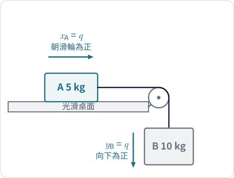
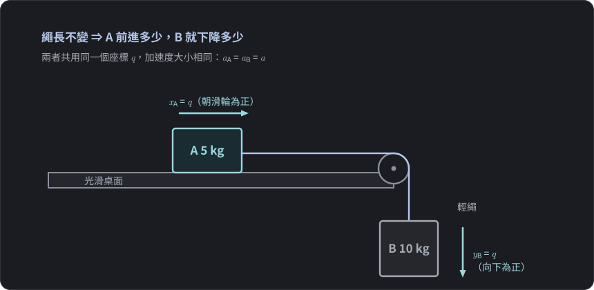
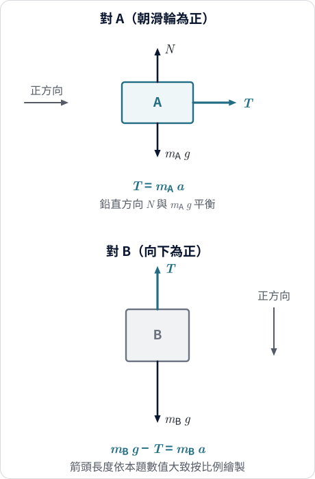
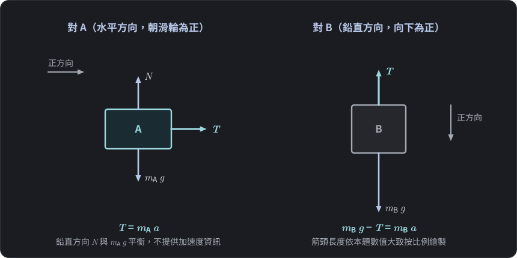

$$\require{physics}$$

<link rel="stylesheet" href="/assets/css/posts-custom.css">

水平光滑桌面上放著質量 $5\ \text{kg}$ 的物體 A，桌邊以輕繩跨過定滑輪，懸掛質量 $10\ \text{kg}$ 的物體 B。放手之後，系統的加速度是多少？繩子的張力又是多少？

這是高中物理裡最常見的連結體問題之一，也是多數人第一次聽到「**整體法**」的地方。老師通常會說：

> 把 A、B 看成一個整體，繩的張力是內力，會互相抵消；外力只剩 B 的重力，所以 $a = m_B g/(m_A+m_B)$。

答案是對的，口訣也很好記。但如果你停下來問自己：A 在水平方向動，B 在鉛直方向動，「合力」到底是怎麼加的？張力真的是「互相抵消」嗎？——你會發現這句話其實省略了很多東西。

這篇文章要做的事，就是把這些被省略的步驟補回來。

## 題目與設定

{: .light w="480" }
{: .dark w="480" }

**圖 1：** 滑車問題。繩長不變，所以 A 朝滑輪前進的距離 $x_A$ 與 B 下降的距離 $y_B$ 相同，都記為 $q$。
{: .fig-caption }

- 物體 A：質量 $m_A = 5\ \text{kg}$，在光滑水平桌面上。
- 物體 B：質量 $m_B = 10\ \text{kg}$，垂掛在桌邊。
- 輕繩不可伸長、質量可忽略；定滑輪無摩擦、質量可忽略。
- 取 $g = 10\ \text{m/s}^2$。

這些「理想化」假設各有用處，後面會逐條回頭檢查：它們分別保證了什麼，拿掉會怎樣。

## 第一步：先問系統「被允許怎麼動」

> **先想一想：** A 往右、B 往下，兩者運動方向完全不同，為什麼可以說它們的加速度「一樣大」？先試著自己說出一個理由，再往下看。

在列任何牛頓方程式之前，先做一件常被跳過的事：**描述運動的限制**。

繩子不可伸長，且保持繃緊。於是 A 往滑輪方向移動多少，B 就必須下降同樣多：

$$x_A = q, \qquad y_B = q$$

這裡 $x_A$ 是 A 朝滑輪方向的位移，$y_B$ 是 B 向下的位移，$q$ 是我們選的**共同座標**。對時間微分兩次，得到

$$a_A = a_B = \ddot q \equiv a$$

注意這個結果的身分：它是**幾何約束**（繩長不變）的結果，不是牛頓定律，也不是力的方程式。後面所有的「整體」操作，都建立在它上面。

更重要的是：原本 A、B 各有一個位置要描述，現在只要一個 $q$。這個系統只有**一個自由度**。

## 解法一：個別分析

分別對兩個物體畫自由體圖，並事先講清楚各自的正方向。

{: .light w="480" }
{: .dark w="480" }

**圖 2：** A、B 的自由體圖。各自選自己的運動方向為正，沿該方向寫牛頓第二定律；A 的鉛直方向 $N$ 與 $m_A g$ 平衡，不含加速度。
{: .fig-caption }

**對 A（水平方向，朝滑輪為正）：** 鉛直方向重力與正向力平衡，水平方向只剩張力：

$$T = m_A a \tag{1}$$

**對 B（鉛直方向，向下為正）：** 重力向下，張力向上：

$$m_B g - T = m_B a \tag{2}$$

這裡用了兩個前提：繩為輕繩、滑輪理想，所以繩上各處張力大小都是 $T$；再加上前面的幾何約束，A、B 的加速度大小都是 $a$。兩個未知數 $T, a$、兩條方程式，聯立：

$$a = \frac{m_B g}{m_A + m_B} = \frac{10\times 10}{5+10} = \frac{20}{3}\ \text{m/s}^2$$

$$T = m_A a = 5\times\frac{20}{3} = \frac{100}{3}\ \text{N} \approx 33.3\ \text{N}$$

檢查一下：B 受到向下的重力 $100\ \text{N}$，張力約 $33.3\ \text{N}$，淨力 $66.7\ \text{N}$，除以 $10\ \text{kg}$ 恰為 $20/3$。兩條方程式一致。

## 解法二：整體法

把 (1) 與 (2) **左右兩邊分別相加**：

$$T + (m_B g - T) = m_A a + m_B a$$

$$m_B g = (m_A + m_B)\,a$$

張力 $T$ 在加總中消失了，直接得到 $a = m_B g/(m_A+m_B)$。

這就是整體法在數學上真正做的事：**把兩條牛頓方程式相加**。它不是什麼新定律，只是對已經合法的方程式做線性組合；而且它能奏效，是因為我們精心選擇了組合方式，讓不想要的未知數剛好消失。

## 兩種解法對照

| | 個別分析 | 整體法 |
|---|---|---|
| 方程式 | 對 A、對 B 各一條，聯立 | 兩條相加，一條 |
| 要處理的未知數 | $a$ 與 $T$ | 只有 $a$ |
| 能直接得到 | $a$ 與 $T$ | 只有 $a$ |
| 前提 | 輕繩、理想滑輪、繩緊 | 同上，再加上「張力在加總中抵消」的條件 |

整體法省下的是聯立的功夫，代價是**看不到張力**。如果題目問張力，還是得把 $a$ 代回 (1) 或 (2)。

## 為什麼 T 會消掉？比「內力」更精確的說法

口訣說「內力互相抵消」，理由常被理解成牛頓第三定律。但仔細看就會發現不對：

- 繩拉 A 的力，水平向右。
- 繩拉 B 的力，鉛直向上。

這兩個力**不是一對作用力與反作用力**，方向也根本不同，在空間中的向量和不是零。它們相加成零，是因為我們沒有在空間中相加，而是各自**沿著物體被允許運動的方向**寫成有號純量：

- 在 (1) 中，張力對 A 的貢獻是 $+T$（沿 A 的正向）。
- 在 (2) 中，張力對 B 的貢獻是 $-T$（沿 B 的正向，B 向下為正，張力向上）。

兩個貢獻剛好符號相反、大小相同，是因為：

1. 輕繩與理想滑輪使繩上張力處處相等（力學條件）；
2. 繩長不變，使 A 前進與 B 前進的距離相同，也就是 $x_A$ 與 $y_B$ 以相同係數（都是 1）隨 $q$ 變化（幾何條件）。

換句話說，**張力消去，是力學與幾何共同作用的結果**。第二個條件在這題顯得理所當然，因為係數剛好都是 1；一旦係數不是 1，結構就會改變——這正是這個系列接下來要追的線索。

## 「系統合力」到底是什麼？

整體法的結果 $m_B g = (m_A + m_B)a$ 看起來像「合力 $m_B g$ 等於總質量乘加速度」，但這個「合力」需要小心解讀。第一個要釐清的是：**張力算不算內力，取決於你把哪些東西劃進「系統」。**

| 系統的選擇 | 張力的身分 | 還要多考慮什麼 |
|---|---|---|
| A + B | 繩對 A、繩對 B 的張力都是**外力** | 兩個張力方向不同（一水平、一鉛直），在向量方程式裡不會消去 |
| A + B + 繩 | 物體與繩之間的張力成為系統**內部**的交互作用 | 滑輪對繩的接觸力變成外力 |
| A + B + 繩 + 滑輪 | 張力完全屬於內部 | 滑輪支架與桌子對系統的力變成外力 |

所以「張力是內力」並非錯誤，它依賴系統的劃分。本文要分清的是兩種不同的操作：

1. **向量方程式 $\sum \vb{F}_{\text{ext}} = M\,\vb{a}_{\text{cm}}$：** 依系統劃分決定哪些力是外力，力要以空間向量相加。
2. **沿共同座標 $q$ 的純量方程式相加：** 這才是整體法在本題做的事，張力是靠有號相加消去的，與「它是不是內力」是兩回事。

所以整體法裡的 $m_B g$ 並不是空間中的向量合力，比較誠實的說法是：

> 整體法裡的 $m_B g$ 是「**沿共同座標 $q$ 方向的有效推動量**」，而 $m_A + m_B$ 是這個運動方向上的「**有效慣性**」。$a$ 是共同座標的二階導數，不一定是質心加速度。

質心加速度與 $a$ 的差異，下一篇的雙斜面會算得更清楚；想先看的讀者，可以跳到文末的延伸一。這句話在本題只是換了一種說法，但在雙斜面與動滑輪中，它會變成必需品。

## 為什麼這些「理想化」假設不能忽略？

| 假設 | 保證了什麼 | 拿掉會怎樣 |
|---|---|---|
| 繩不可伸長、保持繃緊 | $a_A = a_B$（幾何約束） | 兩者加速度可能不同；繩鬆時 $T=0$，兩物體各自獨立 |
| 繩質量可忽略 | 繩上各處張力相等 | 繩本身要被加速，兩端張力不同 |
| 滑輪無摩擦、質量可忽略 | 滑輪兩側張力相等 | 滑輪有轉動慣量時，兩側張力差要用來讓滑輪轉動 |
| 桌面光滑 | A 水平方向只有張力 | 摩擦力為額外外力，需併入沿 $q$ 的力 |

這四條各自對應一個被省略的步驟，口訣「內力消去」把它們全部壓縮成一個詞。

## 容易誤解的五個點

1. **「合力」被當成向量和。** 實際上被加總的是沿各自運動方向的有號純量方程式。
2. **以為牛頓第三定律讓張力抵消。** 繩對 A 與繩對 B 不是作用—反作用對；抵消來自張力相等加上約束係數相同。
3. **把 $a$ 當成質心加速度。** 質心加速度是向量，方向與大小一般都不同於 $a$（見文末延伸一）。
4. **把約束當成力的方程式。** $a_A = a_B$ 是繩長不變的幾何條件，不是牛頓第二定律。
5. **以為整體法萬用。** 它在這題成立，是因為係數都是 1；放到雙斜面、動滑輪時需要重新檢視。

## 給更想追問的你（延伸）

> 以下是進階觀點，不影響高中課程的解題。

### 延伸一：質心加速度不是 $a$

A 向水平方向加速、B 向鉛直方向加速，質心加速度的分量為

$$a_{\text{cm},x} = \frac{m_A a}{m_A+m_B} = \frac{a}{3}, \qquad a_{\text{cm},y} = -\frac{m_B a}{m_A+m_B} = -\frac{2a}{3}$$

大小為 $\dfrac{\sqrt 5}{3}\,a \approx 0.745\,a$，方向是斜的。整體法求出的 $a$ 是共同座標 $q$ 的加速度，不是質心加速度。

### 延伸二：用功與動能得到同一個結果

整體法把兩物體的運動壓縮成了一個座標 $q$，系統的**動能**可以寫成

$$K = \tfrac12 m_A \dot q^2 + \tfrac12 m_B \dot q^2 = \tfrac12 (m_A+m_B)\,\dot q^2$$

從靜止釋放（初動能為零），B 下降 $q$ 的過程中，重力做功 $m_B g\,q$；張力對 A 做功 $+Tq$、對 B 做功 $-Tq$，總和為零。由功與動能定理：

$$m_B g\,q = \tfrac12 (m_A+m_B)\,\dot q^2$$

高中的作法是再用等加速度關係 $\dot q^2 = 2aq$（本題加速度恆定），代入即得

$$m_B g = (m_A+m_B)\,a$$

這條路完全沒用到張力。張力的總功為零，是因為輕繩不可伸長，A 前進的距離等於 B 下降的距離；這是「虛功」與「理想約束」概念的起點，系列後段會回到這裡。

## 本篇學到什麼、還能追問什麼

**本篇學到：**

- 整體法在數學上就是「把牛頓方程式相加」，不是新定律。
- 能夠相加，前提是先有幾何約束，讓 A、B 用同一個共同座標 $q$ 描述。
- 張力消去不是因為牛頓第三定律，而是因為張力相等，加上兩物體沿 $q$ 的係數相同。
- 張力算不算內力，取決於系統怎麼劃分；整體法中張力的消去，是沿 $q$ 的有號相加，不靠「內力成對抵消」。
- 整體法中的「力」是沿 $q$ 方向的有號分量，「質量」是有效慣性，$a$ 不一定是質心加速度。

**還值得追問：**

1. 如果兩物體不在同一條直線上——例如分別在兩個不同傾角的斜面上——整體法還成立嗎？
2. 如果兩物體的加速度大小不同，整體法還能「直接相加」嗎？

第一個問題在 [下一篇：雙斜面連結體]() 回答；第二個問題則在 [動滑輪]() 那篇處理：前者看方向不同但係數仍為 1 的情況，後者看係數不為 1 時，整體法需要怎麼修改。

