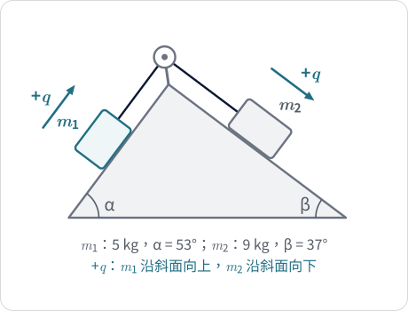
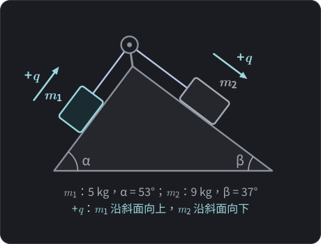
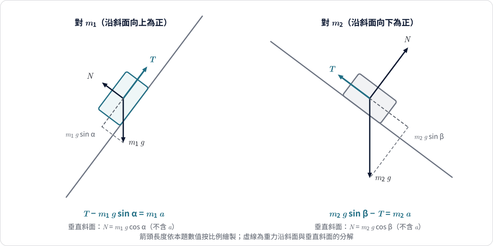
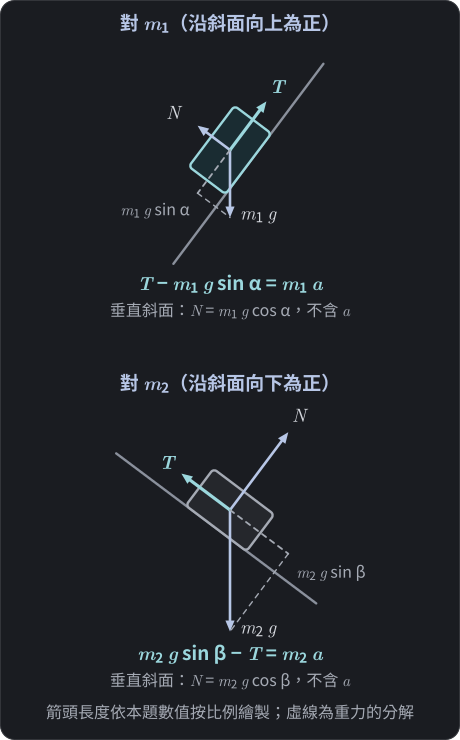

$$\require{physics}$$

<link rel="stylesheet" href="/assets/css/posts-custom.css">

<!-- DRAFT：尚未稽核。圖 1–2 已補。完成稽核後移除此註解。 -->

[上一篇]()我們在水平桌面加垂掛物體的滑車問題裡，把整體法還原成「把兩條牛頓方程式相加」，並發現它能成立靠的是兩件事：繩上張力相等，以及兩物體沿共同座標 $q$ 的係數相同。

這篇把問題推進一步：兩個物體**不再沿著水平與鉛直，而是各在一個傾角不同的斜面上**。

## 題目

{: .light w="480" }
{: .dark w="480" }

**圖 1：** 雙斜面連結體。$m_2$ 沿斜面下滑 $q$，$m_1$ 就沿斜面上滑 $q$；兩個正方向是不同的空間方向，但共用同一個座標 $q$。
{: .fig-caption }

兩個光滑斜面背靠背，頂端有一個定滑輪：

- 物體 $m_1 = 5\ \text{kg}$，在傾角 $\alpha = 53^\circ$ 的斜面上。
- 物體 $m_2 = 9\ \text{kg}$，在傾角 $\beta = 37^\circ$ 的斜面上。
- 輕繩平行於各自的斜面，跨過理想定滑輪；斜面光滑。
- 取 $g = 10\ \text{m/s}^2$，$\sin 53^\circ = 0.8$、$\cos 53^\circ = 0.6$、$\sin 37^\circ = 0.6$、$\cos 37^\circ = 0.8$。

高中課本的整體法寫法是：

$$m_2 g\sin\beta = 54\ \text{N}, \qquad m_1 g\sin\alpha = 40\ \text{N}, \qquad a = \frac{54-40}{5+9} = 1\ \text{m/s}^2$$

這個式子和上一篇的 $a = m_B g/(m_A+m_B)$ 長得很像，但多了一個令人不安的地方：**這兩個 $40\ \text{N}$ 與 $54\ \text{N}$ 的方向並不相同**。它們一個沿左邊斜面，一個沿右邊斜面。方向不同的力，憑什麼直接相減？

> **先想一想：** 如果 $54\ \text{N}$ 與 $40\ \text{N}$ 不能當成共線的力相減，那「減」的依據會是什麼？先試著自己提出一個猜想，再看後面怎麼檢驗。

## 先處理運動的限制

和上一篇一樣，列方程式前先描述系統允許怎麼動。

繩不可伸長且繃緊，所以 $m_2$ 沿自己的斜面向下滑多遠，$m_1$ 就沿自己的斜面向上滑多遠。選定兩個物體各自的**沿斜面正方向**：

- $m_1$：沿斜面**向上**（朝滑輪）為正。
- $m_2$：沿斜面**向下**（遠離滑輪）為正。

設 $m_2$ 沿斜面下滑的距離為 $q$，則兩者沿各自正方向的位移都是 $q$，加速度也都是 $a=\ddot q$。注意：

- 這是**幾何約束**，不是力學方程式。
- 兩個物體各自被限制在一條直線軌道上，彼此又被繩綁在一起，所以整個系統只有**一個自由度**。
- 加速度「大小」相同，但「方向」是兩條不同的斜面方向。

## 為什麼垂直斜面的方程式不提供加速度？

{: .light w="480" }
{: .dark w="480" }

**圖 2：** 兩物體的自由體圖。虛線是重力沿斜面與垂直斜面的分解；沿斜面的兩條方程式含有 $a$，垂直斜面的兩條只決定 $N$。
{: .fig-caption }

對每個物體可以寫兩條方程式：沿斜面一條、垂直斜面一條。

垂直斜面方向，物體沒有加速：物體沿著**固定的直線斜面**運動，所以垂直斜面方向的位置不變，加速度為零：

$$N_1 = m_1 g\cos\alpha = 30\ \text{N}, \qquad N_2 = m_2 g\cos\beta = 72\ \text{N}$$

這兩條只決定了正向力，**加速度根本沒有出現在裡面**：垂直方向的運動被鎖死，正向力只是被動地「調整到剛好」。

要注意，這個結論依賴軌道的幾何形狀。本題的軌道是固定的直線，所以垂直軌道方向的加速度為零；若軌道是曲線（例如沿圓周運動），垂直軌道的方向仍有向心加速度，法向力方程式就會含有 $v^2/R$ 這類項，不能再說「沒有加速度資訊」。這個差別，系列後面談曲線軌道時會再遇到。

真正含有加速度的，是沿斜面的兩條：

**對 $m_1$（沿斜面向上為正）：**

$$T - m_1 g\sin\alpha = m_1 a \tag{1}$$

**對 $m_2$（沿斜面向下為正）：**

$$m_2 g\sin\beta - T = m_2 a \tag{2}$$

## 個別分析與整體法

兩式聯立求解就是個別分析；若直接把 (1)、(2) 左右相加消去 $T$，就是整體法：

$$(1) + (2):\quad m_2 g\sin\beta - m_1 g\sin\alpha = (m_1+m_2)\,a$$

代入數值：

$$54 - 40 = 14\,a \quad\Rightarrow\quad a = 1\ \text{m/s}^2$$

張力用 (1) 求出：

$$T = m_1 a + m_1 g\sin\alpha = 5 + 40 = 45\ \text{N}$$

用 (2) 檢查：$54 - 45 = 9 = 9\times 1$，一致。

## 到底為什麼可以相減？

關鍵是看清楚**被加總的是什麼**。

(1) 與 (2) 都是標量方程式。每一條都是「沿該物體自己的軌道，朝該物體自己的正方向」的牛頓第二定律。之所以能把 (1) 和 (2) 相加，不是因為 $40\ \text{N}$ 和 $54\ \text{N}$ 在空間中共線，而是因為：

1. 兩個正方向是由**同一個 $q$** 定義的：$q$ 增加時，$m_1$ 沿它的正方向前進，$m_2$ 也沿它的正方向前進，位移與加速度的係數都是 $1$。
2. 在這個約定下，重力分量對 $q$ 的貢獻是：$m_2$ 的 $+54$、$m_1$ 的 $-40$，符號的來源是「它促進還是阻礙 $q$ 增加」，而不是空間方向的相反。
3. 張力對兩者的貢獻分別是 $+T$ 與 $-T$，加總抵消，原因和上一篇相同：輕繩與理想滑輪使張力相等，加上兩個係數都是 $1$。

所以 $54-40$ 的「減」，是**沿共同座標 $q$ 的有號相加**。如果你把兩個力畫在同一個平面上做向量相加，得到的合力方向與大小都和 $14\ \text{N}$ 無關。

## 這個 $a$ 是什麼？它不是質心加速度

假設左斜面向右上升到頂端，右斜面向右下降。在這個座標下，$m_1$ 的加速度方向是沿斜面向上，單位向量是 $(\cos 53^\circ, \sin 53^\circ) = (0.6, 0.8)$；$m_2$ 的加速度方向是沿斜面向下，單位向量是 $(\cos 37^\circ, -\sin 37^\circ) = (0.8, -0.6)$。

質心加速度為

$$\vb{a}_{\text{cm}} = \frac{m_1\,a\,(0.6,\,0.8) + m_2\,a\,(0.8,\,-0.6)}{m_1+m_2} = \frac{a}{14}\,(10.2,\,-1.4)$$

大小約為 $0.735\,a \approx 0.74\ \text{m/s}^2$。

這和整體法裡的 $a = 1\ \text{m/s}^2$ 不同。換言之：

| 量 | 數值 | 意義 |
|---|---|---|
| $a=\ddot q$ | $1\ \text{m/s}^2$ | 共同座標的加速度，也是兩物體各自沿斜面的加速度大小 |
| $a_{\text{cm}}$ | 約 $0.74\ \text{m/s}^2$ | 質心的真實空間加速度，方向斜向右下 |
| $14\ \text{N}$ | — | 沿 $q$ 方向的有效推動量，不是空間中的合外力 |
| $14\ \text{kg}$ | — | 沿 $q$ 方向的有效慣性，這題碰巧等於總質量 |

整體法的 $a$ 之所以答案是對的，並不是因為它代表質心，而是因為它是**共同座標 $q$ 的加速度**。

> **再追問一步：** 若維持兩物體的質量與沿斜面加速度大小 $a$，只改變傾角，質心加速度會怎麼變？
>
> 設兩物體加速度方向的夾角為 $\theta$（本題中 $\theta=\alpha+\beta=90^\circ$），則
>
> $$\lvert\vb{a}_{\text{cm}}\rvert = a\,\frac{\sqrt{m_1^2+m_2^2+2m_1m_2\cos\theta}}{m_1+m_2}$$
>
> 代入 $\theta=90^\circ$ 得 $a\sqrt{106}/14\approx 0.735\,a$，與上面一致。夾角變了，質心加速度就變，但整體法裡的 $a=\ddot q$ 完全不受影響。這再次說明兩者是不同的量。

## 容易誤解的幾點

1. **把 $40\ \text{N}$ 與 $54\ \text{N}$ 當成共線的力相減。** 它們在空間中方向不同；相減的依據是共同座標 $q$ 下的正負號。
2. **用垂直斜面方程式求加速度。** 本題軌道是固定直線，垂直方向沒有加速度，只決定正向力；曲線軌道則不然。
3. **把 $a$ 當質心加速度。** 兩者不同，這題數值為 $1$ 對約 $0.74$。
4. **以為斜面的方向關係（本題兩個軌道恰好互相垂直）是整體法成立的原因。** 即使傾角換成別的值，只要有共同座標 $q$ 且係數相同，結論形式不變。
5. **忘記檢查正負號。** 若算出 $a<0$，代表系統實際往 $q$ 的反方向運動；若兩邊重力分量剛好相等，則 $a=0$ 為靜止平衡。

## 一般式與一個小檢驗

把數字換成符號，得到

$$a = \frac{m_2\sin\beta - m_1\sin\alpha}{m_1+m_2}\,g$$

兩個特例可以檢驗它：

- $\alpha = 0$（左邊是水平桌面）：$a = \dfrac{m_2 g\sin\beta}{m_1+m_2}$，這就是上一篇滑車問題的斜面版本；若再令 $\beta=90^\circ$，剛好回到 $a = m_B g/(m_A+m_B)$。
- $m_1\sin\alpha = m_2\sin\beta$：$a=0$，兩邊重力沿斜面的分量恰好平衡。

## 給更想追問的你（延伸）

> 進階觀點，不影響高中解題。

另一個看 $54-40$ 的方式是**做功**。當 $q$ 增加一小段 $\delta q$：

- $m_2$ 沿斜面下滑 $\delta q$，重力做功 $+54\,\delta q$。
- $m_1$ 沿斜面上滑 $\delta q$，重力做功 $-40\,\delta q$。
- 張力對 $m_1$ 做 $+T\,\delta q$，對 $m_2$ 做 $-T\,\delta q$，總和為零。

總功是 $(54-40)\,\delta q = 14\,\delta q$，這就是「沿 $q$ 的有效推動量」。這種寫法完全不需要提到張力或正向力，是後面「虛功」觀點的前身。

## 本篇學到什麼、還能追問什麼

**本篇學到：**

- 不同方向的力能相減，依據是共同座標 $q$ 下的有號分量，而不是空間向量。
- 垂直斜面的方程式只決定正向力，不提供加速度。
- 整體法的 $a$ 是 $\ddot q$，不是質心加速度，本題兩者數值不同。
- 本題的係數都是 $1$，所以相加的結構和上一篇完全一樣。

**還值得追問：**

如果兩個物體加速度的**大小**本來就不相同，會怎樣？例如繩子繞過一個會跟著移動的動滑輪，一端的物體每動 $1\ \text{m}$，另一端的物體要動 $2\ \text{m}$。這時 (1) 與 (2) 還能「直接相加」嗎？答案在 [下一篇：動滑輪]() 揭曉。

