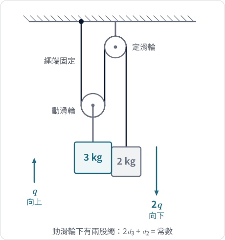
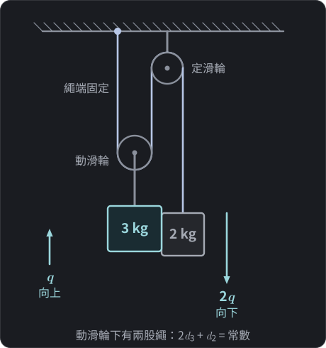
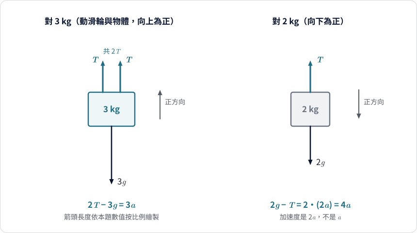
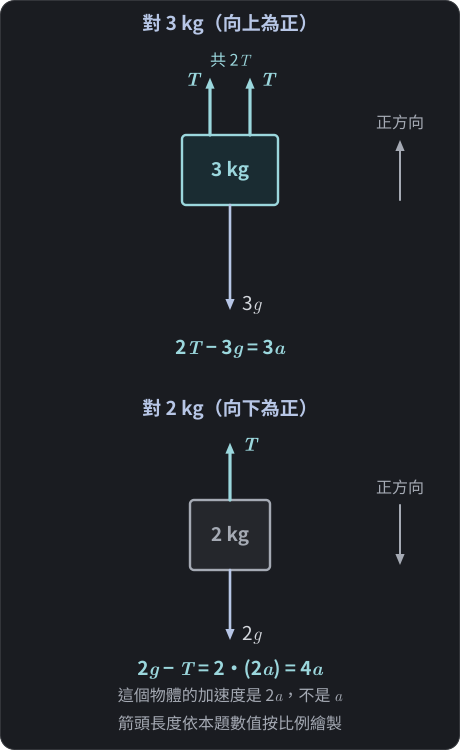

$$\require{physics}$$

<link rel="stylesheet" href="/assets/css/posts-custom.css">

<!-- DRAFT：尚未稽核。圖 1–2 已補。完成稽核後移除此註解。 -->

前兩篇（[滑車]()、[雙斜面]()）的連結體，不論是水平桌面加垂掛，還是雙斜面，有一個共同點：繩子拉動的兩個物體**移動的距離一樣多**，所以加速度大小相同，兩條方程式可以直接相加。

這篇把這個共同點拿掉。當繩子繞過一個會跟著移動的**動滑輪**，兩個物體的加速度大小就不一樣了。這時，高中常見的那句「合力除以總質量」會發生什麼事？

## 題目

{: .light w="480" }
{: .dark w="480" }

**圖 1：** 動滑輪系統。動滑輪下有兩股繩支撐，所以動滑輪上升 $q$ 時，2 kg 物體要下降 $2q$（箭頭長度為 $1:2$）。
{: .fig-caption }

- 一條不可伸長的理想輕繩，一端固定在天花板。
- 繩向下繞過一個動滑輪，滑輪下掛著 $3\ \text{kg}$ 的物體（滑輪本身質量與摩擦忽略）。
- 繩再向上繞過天花板上的定滑輪，自由端垂下，掛著 $2\ \text{kg}$ 的物體。
- 取 $g = 10\ \text{m/s}^2$。

問兩個物體的加速度與繩上張力。

> **先想一想：** ① 動滑輪往上移動 $10\ \text{cm}$，繩子自由端那邊的 $2\ \text{kg}$ 物體會移動多少？② $3\ \text{kg}$ 比 $2\ \text{kg}$ 重，它一定往下嗎？先寫下你的預測，後面會逐一檢驗。

## 先檢驗一個猜想：「重量相減除以總質量」

假設我們忘了前兩篇一路強調的條件，只記得「兩個重量相減，再除以總質量」。這是一個**故意拿來檢驗的猜想**，並不是前兩篇方法的推論。外力是兩個重力，一個向上的 $3g$ 對向下的 $2g$，所以

$$a \overset{?}{=} \frac{2g - 3g}{3 + 2} = -\frac{g}{5}$$

負號代表較輕的 $2\ \text{kg}$ 被拉起、較重的 $3\ \text{kg}$ 下降，大小是 $g/5$。看起來合情合理。

但等一下會算出，實際運動是 $3\ \text{kg}$ 往**上**、$2\ \text{kg}$ 往**下**，方向剛好相反。這個猜想在這裡不只是數值不準，連方向都錯，必須找出它哪裡出了問題。

## 第一步：幾何約束

和前兩篇一樣，先不碰力，先問系統能怎麼動。

設兩個量：

- $d_3$：動滑輪（即 $3\ \text{kg}$ 物體）的中心在天花板下方的深度。
- $d_2$：$2\ \text{kg}$ 物體在定滑輪下方的深度。

繩子的總長可以拆成幾段：

- 從天花板固定點垂直下降到動滑輪左側的一段，長度約為 $d_3$。
- 從動滑輪右側垂直上升到定滑輪的一段，長度同樣約為 $d_3$。
- 繞過滑輪的圓弧段，長度不變。
- 從定滑輪垂下到 $2\ \text{kg}$ 物體的一段，長度為 $d_2$。

於是繩長不變的條件是

$$2\,d_3 + d_2 = \text{常數}$$

位移變化量滿足 $2\,\Delta d_3 + \Delta d_2 = 0$。換句話說：**動滑輪下降 $\Delta d_3$，$2\ \text{kg}$ 物體就要上升 $2\,\Delta d_3$**。反過來，動滑輪上升 $q$，$2\ \text{kg}$ 物體就下降 $2q$。

這裡的 $2$ 來自動滑輪下有**兩段繩子**在支撐它。它是純幾何的結果，與力無關。

選定正方向：

- $3\ \text{kg}$ 物體：**向上**為正，位移 $s_3 = q$，加速度 $a_3 = \ddot q \equiv a$。
- $2\ \text{kg}$ 物體：**向下**為正，位移 $s_2 = 2q$，加速度 $a_2 = 2\ddot q = 2a$。

整個系統仍然只有一個自由度 $q$，但現在兩個物體的位移對 $q$ 的**係數不同**：$c_3 = 1$、$c_2 = 2$。

## 個別分析

輕繩加上理想滑輪，整條繩上張力處處為 $T$。

{: .light w="480" }
{: .dark w="480" }

**圖 2：** 兩物體的自由體圖。$3\ \text{kg}$ 受兩股張力，所以向上的力是 $2T$；$2\ \text{kg}$ 的加速度是 $2a$，不是 $a$。
{: .fig-caption }

**對 $3\ \text{kg}$（向上為正）：** 動滑輪兩側各有一段繩向上拉，共 $2T$；重力 $3g$ 向下：

$$2T - 3g = 3a \tag{1}$$

**對 $2\ \text{kg}$（向下為正）：** 重力 $2g$ 向下，張力 $T$ 向上，加速度為 $2a$：

$$2g - T = 2\,(2a) = 4a \tag{2}$$

這兩條方程式各自都是正確的牛頓第二定律；它們用的是各自物體自己的正方向。把 (2) 代入 (1) 消去 $T$：由 (2) 得 $T = 2g - 4a$，代入 (1)：

$$2(2g - 4a) - 3g = 3a \;\Rightarrow\; g = 11a$$

$$a_3 = a = \frac{g}{11} \approx 0.91\ \text{m/s}^2\ (\text{向上}), \qquad a_2 = 2a = \frac{2g}{11} \approx 1.82\ \text{m/s}^2\ (\text{向下})$$

$$T = 2g - 4a = \frac{18g}{11} \approx 16.4\ \text{N}$$

$3\ \text{kg}$ 雖然比較重，卻是上升的一方。這裡有兩件不同的事，要分開看：

- **力：** 動滑輪受到兩段繩合計 $2T$ 的向上拉力；$2\ \text{kg}$ 只受一段繩的 $T$。繩子並沒有把 $2g$「放大」成 $4g$，事實上 $T<2g$，因為 $2\ \text{kg}$ 本身正在加速。
- **運動：** 繩長約束使 $2\ \text{kg}$ 的位移是 $3\ \text{kg}$ 的兩倍。

兩個物體不再以 $1:1$ 的比例對應同一個 $q$，這個換算比例就是下面要用 $c_i$ 量化的東西。

## 為什麼前兩篇的「直接相加」在這裡行不通？

直接把 (1) 與 (2) 相加：

$$(2T - 3g) + (2g - T) = 3a + 4a \;\Rightarrow\; T - g = 7a$$

$T$ 沒有消掉。原因很清楚：在 (1) 裡張力的係數是 $2$（兩股繩），在 (2) 裡是 $1$（一股繩）。要讓 $T$ 消去，必須把 (2) 乘上 $2$ 再與 (1) 相加：

$$(2T - 3g) + 2\,(2g - T) = 3a + 2\,(4a)$$

$$g = 11a$$

這就是整體法在動滑輪裡的樣子：**不是直接相加，而是加權相加**。這個「2」不是為了湊答案，它的來源是同一個東西：

- 繩長約束告訴我們 $s_2 = 2 s_3$，也就是 $c_2 = 2$；
- 乘上 $c_2=2$ 之後，張力的貢獻 $2T$ 與 $-2T$ 恰好抵消。

## 11 是怎麼來的？

加權相加之後，右邊的係數是

$$3\cdot 1^2 + 2\cdot 2^2 = 3 + 8 = 11$$

每個物體的質量被乘上了 $c_i^2$：一次來自 $a_i = c_i a$（加速度大小），一次來自我們為了消去張力而乘上的權重 $c_i$。所以 $11$ 並不是「總質量」，它是**沿 $q$ 方向的有效慣性**：

$$M_{\text{eff}} = \sum_i m_i c_i^2 = 3\cdot 1^2 + 2\cdot 2^2 = 11\ \text{kg}$$

直觀上，$2\ \text{kg}$ 物體要以兩倍的速度運動，所以它在這個運動模式中「對慣性的貢獻」是 $2\cdot 2^2 = 8$，遠比 $3\ \text{kg}$ 物體的 $3$ 大。

右邊同理，要算重力沿 $q$ 的「有效推動量」。這一步要小心符號。$q$ 增加對應 $3\ \text{kg}$ 上升、$2\ \text{kg}$ 下降，所以：

- $3\ \text{kg}$ 的重力向下，阻礙 $q$ 增加，貢獻 $1\times(-3g)$；
- $2\ \text{kg}$ 的重力向下，促進 $q$ 增加，貢獻 $2\times(+2g)$。

$$Q = -3g + 4g = g$$

於是 $Q = M_{\text{eff}}\,a$ 就是 $g = 11a$。

## 現在回頭看：口訣哪裡錯了？

「合力除以總質量」錯在兩個地方：

1. **權重被忽略：** 重力 $2g$ 作用在位移是 $2q$ 的物體上，$q$ 增加 $\delta q$ 時它做功 $2g\cdot 2\delta q$，貢獻是 $2\times 2g$，卻被當成 $1\times 2g$ 計算。
2. **質量被忽略：** $2\ \text{kg}$ 物體以兩倍速度運動，對慣性的貢獻是 $4$ 倍，卻被當成 $1$ 倍計算。

精確地說，$c_i$ 的定義是物體 $i$ 沿自己運動方向的位移對共同座標的變化率，$c_i = \mathrm{d}s_i/\mathrm{d}q$；本題中它是常數，所以也等於速度與加速度的有號比例。

如果想要一個類比：就像兩個人坐在槓桿上，不能只看誰比較重，還要看離支點多遠，$c_i$ 扮演類似「力臂比」的角色。但這只是類比，它在功與能量上的結構相似，並不是空間中真的有一根槓桿。前兩篇的 $c_i$ 全是 $1$，所以這個角色看不出來。

## 平衡與驗算

兩個簡單的檢驗：

- **平衡條件：** $a=0$ 時，由 (2) 得 $T = m_2 g$，再由 (1) 得 $2T = m_3 g$，所以平衡條件是 $m_3 = 2m_2$。本題 $m_3 = 3 < 2m_2 = 4$，代表 $2\ \text{kg}$ 一側「更有力量」往下拉，所以 $2\ \text{kg}$ 下降、$3\ \text{kg}$ 上升，和 $g=11a>0$ 的結果一致。
- **張力不是 $m_2 g$：** 因為 $2\ \text{kg}$ 物體在加速，$T = 2g - 4a = 18g/11 \approx 16.4\ \text{N}$，小於 $m_2 g=20\ \text{N}$。

## 容易誤解的幾點

1. **以為加速度大小相同。** 動滑輪使 $a_2 = 2a_3$，這是繩長約束的結果。
2. **在 $3\ \text{kg}$ 物體上少算一股繩。** 動滑輪兩側各有一股張力，總力為 $2T$。
3. **直接相加方程式。** 若 $T$ 沒消掉，代表忘了乘上約束係數。
4. **權重當成技巧。** 乘 $2$ 不是湊答案，是從 $s_2 = 2 s_3$ 來的。
5. **把 $11$ 當成質量。** $11$ 是 $\sum m_i c_i^2$，是有效慣性，不等於總質量 $5\ \text{kg}$。

## 給更想追問的你（延伸）

> 進階觀點，不影響高中解題。

從能量看更直接。當 $q$ 增加，$3\ \text{kg}$ 上升 $q$，$2\ \text{kg}$ 下降 $2q$。重力做功：

$$W = -3g\,q + 2g\,(2q) = g\,q$$

動能：

$$K = \tfrac12\cdot 3\,\dot q^2 + \tfrac12\cdot 2\,(2\dot q)^2 = \tfrac12\cdot 11\,\dot q^2$$

張力對兩個物體做功為 $+2T\,q$（對 $3\ \text{kg}$）與 $-T\cdot 2q$（對 $2\ \text{kg}$），總和是零。所以 $11$ 與 $g$ 都自然從功與動能裡冒出來，不需要處理張力。

從靜止釋放時，$g\,q = \tfrac12\cdot 11\,\dot q^2$；和第一篇的延伸二一樣，再配合等加速度關係 $\dot q^2 = 2aq$，就得到 $a = g/11$。這就是「為什麼約束力可以不出現」的另一個說法。

## 本篇學到什麼、還能追問什麼

**本篇學到：**

- 動滑輪使兩物體的位移對共同座標 $q$ 的係數不同（這題是 $c_3 = 1$、$c_2 = 2$），係數來自繩長約束。
- 整體法在這種情況下要**加權**：每條方程式乘上自己的 $c_i$ 再相加，張力才會抵消。
- 有效慣性是 $\sum m_i c_i^2 = 11$，不是總質量 $5$。
- 沿 $q$ 的有效推動量是 $\sum c_i F_i = g$，不是向量合力。

**還值得追問：**

我們已經看了三個例子：滑車、雙斜面、動滑輪。它們的規律能不能寫成一個通用的式子，不論有幾個物體、幾股繩，都適用？未來會嘗試把這三個例子的共同結構整理出來。

