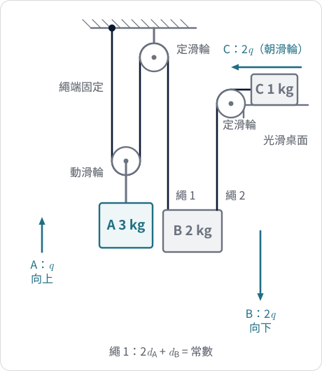
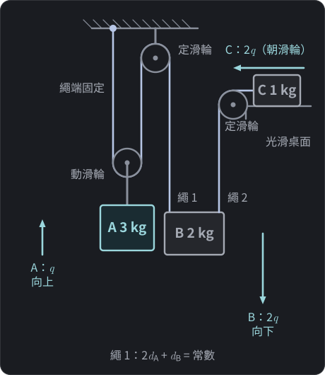
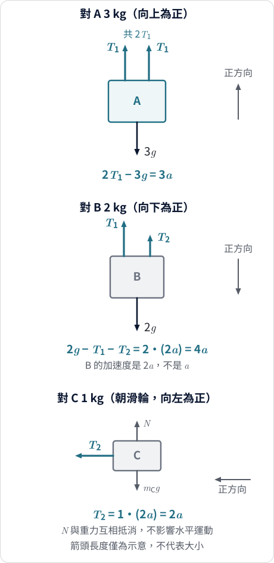
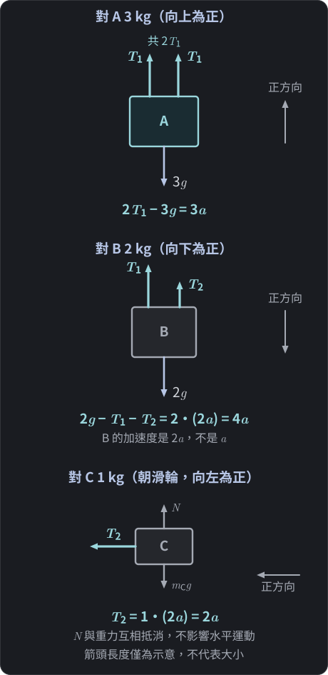

$$\require{physics}$$

<link rel="stylesheet" href="/assets/css/posts-custom.css">

<!-- DRAFT：尚未稽核。圖 1–2 已補。完成稽核後移除此註解。 -->

前三篇我們做了三題連結體：

| 題目 | $c_i$ | 乘數 |
|---|---|---|
| [滑車]() | $(1,\ 1)$ | $(1,\ 1)$ |
| [雙斜面]() | $(1,\ 1)$ | $(1,\ 1)$ |
| [動滑輪]() | $(1,\ 2)$ | $(1,\ 2)$ |

表中 $c_i$ 是繩長約束給出的位移係數，「乘數」是前三篇消去張力時乘在各方程式上的係數。每一題的乘數，都和位移係數一模一樣。這會是巧合嗎？前三篇的題目都只有兩個物體、一條繩，張力只有一個。如果有三個物體、兩條繩，會出現兩個互不相干的張力，這個規律還在嗎？

這篇用一題更複雜的連結體，讓你親手把乘數找出來，再整理成一條通用的式子。

## 題目

{: .light w="480" }
{: .dark w="480" }

**圖 1：** 三物體連結體。繩 1 接 B 的左側吊鉤，繩 2 接 B 的右側吊鉤，兩條繩都是鉛直向上拉 B。箭頭長度為 $1:2:2$。
{: .fig-caption }

- **繩 1：** 一端固定在天花板，向下繞過動滑輪（下方掛 A，$3\ \text{kg}$），再向上繞過天花板上的定滑輪，垂下接到 B（$2\ \text{kg}$）。
- **繩 2：** 一端接在 B 上，向上繞過桌邊的定滑輪後水平延伸，接到光滑桌面上的 C（$1\ \text{kg}$）。
- 繩是不可伸長的理想輕繩，滑輪質量與摩擦忽略，兩條繩始終繃緊。
- 取 $g = 10\ \text{m/s}^2$，從靜止釋放。

求三個物體的加速度與兩條繩的張力。

> **先想一想：** ① A 往上移動 $10\ \text{cm}$，B 和 C 各移動多少？② A 最重，但它一定往下嗎？先寫下你的預測。

## 第一步：幾何約束

和前三篇一樣，先不碰力，只問系統能怎麼動。

**繩 1。** 設 $d_A$ 是動滑輪（A）在天花板下方的深度，$d_B$ 是 B 在定滑輪下方的深度。繩 1 的長度為

$$2\,d_A + d_B = \text{常數}$$

（動滑輪下方有兩股繩，與[上一篇]()相同。）A 上升 $q$，$d_A$ 減少 $q$，$d_B$ 就增加 $2q$：B 下降 $2q$。

**繩 2。** B 在桌邊滑輪下方，繩 2 的長度是「鉛直段 $+$ 水平段」。B 下降 $2q$，鉛直段變長 $2q$，水平段就必須縮短 $2q$：C 朝滑輪前進 $2q$。

選定每個物體各自的正方向：

- A：向上為正，$s_A = q$。
- B：向下為正，$s_B = 2q$。
- C：朝滑輪（圖中向左）為正，$s_C = 2q$。

三個物體的位移比是 $1:2:2$，所以加速度也是 $a_A : a_B : a_C = 1 : 2 : 2$。設 $a \equiv \ddot q$，則

$$a_A = a,\qquad a_B = 2a,\qquad a_C = 2a$$

整個系統仍然只有**一個自由度** $q$，位移係數是 $c_A = 1,\ c_B = 2,\ c_C = 2$。這些係數只由幾何決定，目前還沒有用到任何一條力學方程式。

## 個別分析

{: .light w="480" }
{: .dark w="480" }

**圖 2：** 三個物體的自由體圖，各自使用自己的正方向。B 受兩條繩的拉力 $T_1$、$T_2$，且加速度是 $2a$。
{: .fig-caption }

繩 1 與繩 2 是兩條不同的繩，張力 $T_1$、$T_2$ 一般不相等。

**A（向上為正）：** 動滑輪兩側各有一股 $T_1$ 向上拉，共 $2T_1$：

$$2T_1 - 3g = 3a \tag{1}$$

**B（向下為正）：** 重力 $2g$ 向下，$T_1$、$T_2$ 都向上，加速度 $2a$：

$$2g - T_1 - T_2 = 2\,(2a) = 4a \tag{2}$$

**C（朝滑輪為正）：** 鉛直方向的重力與支持力互相抵消，水平方向只有 $T_2$：

$$T_2 = 1\cdot(2a) = 2a \tag{3}$$

三個未知數（$a,\ T_1,\ T_2$）、三條方程式。這是個別法，一定解得出來，但要消兩個張力。整體法的想法是：能不能挑一組乘數，一次把兩個張力都消掉？

## 自己找乘數

先把三條方程式都寫成「力 $-$ 質量乘加速度 $= 0$」的形式：

$$\begin{aligned}
(2T_1 - 3g) - 3a &= 0 &&(1')\\
(2g - T_1 - T_2) - 4a &= 0 &&(2')\\
T_2 - 2a &= 0 &&(3')
\end{aligned}$$

把 $(1')$ 乘上 $\lambda_A$、$(2')$ 乘上 $\lambda_B$、$(3')$ 乘上 $\lambda_C$，再相加。看 $T_1$ 與 $T_2$ 的係數：

| | $T_1$ 的係數 | $T_2$ 的係數 |
|---|---|---|
| 來自 $(1')$ | $+2\lambda_A$ | $0$ |
| 來自 $(2')$ | $-\lambda_B$ | $-\lambda_B$ |
| 來自 $(3')$ | $0$ | $+\lambda_C$ |

要讓兩個張力同時消失：

$$2\lambda_A - \lambda_B = 0,\qquad -\lambda_B + \lambda_C = 0$$

這是兩條條件、三個未知數，解不唯一，只能決定比例：$\lambda_B = 2\lambda_A$，$\lambda_C = \lambda_B = 2\lambda_A$。取 $\lambda_A = 1$：

$$(\lambda_A,\ \lambda_B,\ \lambda_C) = (1,\ 2,\ 2)$$

這組乘數和剛才算出的位移係數 $(c_A, c_B, c_C) = (1, 2, 2)$ 一模一樣。先記下這個發現，後面會回頭談它說明了什麼、沒說明什麼。

用 $(1,\ 2,\ 2)$ 加權相加，兩個張力都消失，剩下重力與慣性項：

$$(-3g + 4g) - (3 + 8 + 4)\,a = 0 \;\Rightarrow\; g = 15\,a$$

所以

$$a = \frac{g}{15} = \frac{2}{3}\ \text{m/s}^2$$

### 回代與驗算

- $a_A = \tfrac23\ \text{m/s}^2$（向上），$a_B = \tfrac43\ \text{m/s}^2$（向下），$a_C = \tfrac43\ \text{m/s}^2$（朝滑輪）。
- 由 (3)：$T_2 = 2a = \tfrac43\ \text{N}$。
- 由 (1)：$2T_1 = 3g + 3a = 30 + 2 = 32$，所以 $T_1 = 16\ \text{N}$。
- 檢驗 (2)：$2g - T_1 - T_2 = 20 - 16 - \tfrac43 = \tfrac83 = 4a$。✓
- 兩個張力都大於零，繩子確實是繃緊的，前面「始終繃緊」的假設自洽。

最重的 A（$3\ \text{kg}$）是向**上**加速。原因和上一篇一樣：B 的位移是 A 的兩倍，它的重力在沿 $q$ 方向的貢獻較大。

## 從例子抽出公式

把剛才的步驟寫成一般形式。

假設每個物體 $i$ 都沿一條**固定的直線**運動，並選一個正方向，用 $s_i$ 表示它沿這條直線的位置。若整個系統只有一個自由度 $q$，且

$$s_i = c_i\,q + b_i \qquad (c_i,\ b_i\ \text{是常數})$$

則 $\ddot s_i = c_i\,\ddot q$。

物體 $i$ 沿這條直線的牛頓第二定律是

$$m_i\,\ddot s_i = F_i + R_i$$

- $F_i$：沿路徑方向的**已知外力**（例如重力的分量）。
- $R_i$：沿路徑方向的**約束力**（繩張力等）。

兩邊乘上 $c_i$ 並對所有物體相加：

$$\sum_i m_i c_i^2\,\ddot q = \sum_i c_i F_i + \sum_i c_i R_i$$

如果約束力的加權和為零，$\sum_i c_i R_i = 0$，張力就消失了：

$$\boxed{\;\sum_i c_i F_i \;=\; \Bigl(\sum_i m_i c_i^2\Bigr)\ddot q\;}$$

左邊記成 $Q$（沿 $q$ 的**廣義力**，也就是「有效推動量」），括號記成 $M_{\text{eff}}$（沿 $q$ 的**有效慣性**）：

$$Q = M_{\text{eff}}\,\ddot q$$

用本題檢驗：約束力是 $R_A = 2T_1$、$R_B = -(T_1 + T_2)$、$R_C = T_2$（都已經取成各自正方向），所以

$$\sum_i c_i R_i = 1\cdot 2T_1 + 2\cdot\bigl(-T_1 - T_2\bigr) + 2\cdot T_2 = 0 \quad ✓$$

已知外力只有重力：A 向下（阻礙 $q$ 增加）、B 向下（促進 $q$ 增加）、C 在鉛直方向（不影響水平路徑）：

$$\begin{aligned}
Q &= 1\cdot(-3g) + 2\cdot(2g) + 2\cdot 0 = g\\
M_{\text{eff}} &= 3\cdot 1^2 + 2\cdot 2^2 + 1\cdot 2^2 = 15
\end{aligned}$$

這正是 $g = 15\,a$。

### 前三題也是同一條式子

| 題目 | $c_i$ | $Q$ | $M_{\text{eff}}$ | $\ddot q$ |
|---|---|---|---|---|
| 滑車（$5\ \text{kg}$ 與 $10\ \text{kg}$） | $(1,\ 1)$ | $m_B g = 100\ \text{N}$ | $5 + 10 = 15\ \text{kg}$ | $\tfrac{20}{3}\ \text{m/s}^2$ |
| 雙斜面（$5\ \text{kg}$ 與 $9\ \text{kg}$） | $(1,\ 1)$ | $54 - 40 = 14\ \text{N}$ | $5 + 9 = 14\ \text{kg}$ | $1\ \text{m/s}^2$ |
| 動滑輪（$3\ \text{kg}$ 與 $2\ \text{kg}$） | $(1,\ 2)$ | $g$ | $11\ \text{kg}$ | $g/11$ |
| 本篇（$3,\ 2,\ 1\ \text{kg}$） | $(1,\ 2,\ 2)$ | $g$ | $15\ \text{kg}$ | $g/15$ |

前兩題 $c_i$ 都是 $1$，所以 $M_{\text{eff}}$ 剛好等於總質量，這就是「合力除以總質量」看起來對的原因。後兩題 $c_i$ 不全是 $1$，$M_{\text{eff}}$ 就不再是總質量。

### 要小心的幾件事

- **$\ddot q$ 不是質心加速度。** 本題三個物體往不同方向動，質心加速度是三個加速度的質量加權向量和，和 $\ddot q$ 是兩回事；$\ddot q$ 只是「我們選的那個共同座標」的加速度。
- **$M_{\text{eff}}$ 不是質量。** 本題的總質量是 $6\ \text{kg}$，但 $M_{\text{eff}} = 15$。
- **$Q$ 不是向量合力。** 它是各個力在各自路徑上的分量，乘上 $c_i$ 再相加得到的純量。

## 這條公式什麼時候能用？

上面的推導用了幾個前提。把它們攤開來看：

| 條件 | 這題如何滿足 | 不滿足時 |
|---|---|---|
| 每個物體沿固定直線運動 | A、B 鉛直、C 水平，軌道固定 | 曲線軌道：$c_i$ 會隨位置改變，推導多出額外的項 |
| $s_i = c_i q + b_i$（常數係數的線性關係） | 繩長約束是線性的 | 像單擺這類非線性約束：$c_i$ 不是常數 |
| 只有一個自由度 | 一個 $q$ 就決定全部位置 | 有多個獨立的運動方式，需要多個座標與多條方程式 |
| $\sum c_i R_i = 0$（約束力的加權和為零） | 已逐項驗證為 $0$ | 繩鬆弛、有未知大小的摩擦：不能直接用 |
| 繩始終繃緊（$T > 0$） | $T_1 = 16\ \text{N}$、$T_2 = \tfrac43\ \text{N}$ | 張力算出來是負的，代表繩已鬆弛，位移關係不成立 |

最後兩條有關係：繩要繃緊，才有「繩長不變」的約束；有了約束，才有 $s_i = c_i q + b_i$。

## 目前的證據夠嗎？

回到開頭的問題：為什麼消去張力的乘數剛好等於位移係數？

這篇做了什麼：

- 在四個題目裡，把 $\sum c_i R_i$ 算出來，每一次都是 $0$。
- 在本題，乘數的條件 $2\lambda_A-\lambda_B=0$、$-\lambda_B+\lambda_C=0$，恰好被 $(1,2,2)$ 滿足。

這篇**沒有**做的事：

- 沒有證明「任何理想約束，$\sum c_i R_i$ 一定是 $0$」。
- 沒有證明乘數一定等於 $c_i$。

四個例子一致，只能說明規律值得認真看待，不能當成證明。例如，換成一個有摩擦的系統，這個規律就不再成立。真正的理由和「約束力在允許的運動方向上不做功」有關，這需要「虛位移」這個概念，會在未來的文章裡處理。

## 容易誤解的幾點

1. **把 $c_i$ 當成力臂。** 它是位移對 $q$ 的變化率 $\mathrm{d}s_i/\mathrm{d}q$，和槓桿只是形式上類似。
2. **以為乘數可以隨便挑。** 乘數必須讓所有張力同時消失；挑錯了，張力還在。
3. **只乘到方程式的一邊。** 方程式兩邊都要乘同一個係數。
4. **忘了各自的正方向。** 本題 A 向上為正、B 向下為正、C 朝滑輪為正；$c_i$ 的符號依這些選擇而定。
5. **算完不檢查張力正負。** 張力若出現負值，代表繩子不可能維持繃緊，答案無效。
6. **把「四個例子都對」當成證明。** 這是歸納，不是推導。

## 給更想追問的你（延伸）

> 進階觀點，不影響高中解題。

用功率的語言看，更容易看出公式的結構。因為 $\dot s_i = c_i\dot q$，所有物體的動能是

$$K = \sum_i \tfrac12 m_i \dot s_i^{\,2} = \tfrac12\Bigl(\sum_i m_i c_i^2\Bigr)\dot q^{\,2} = \tfrac12 M_{\text{eff}}\,\dot q^{\,2}$$

已知外力的總功率是

$$P = \sum_i F_i\,\dot s_i = \Bigl(\sum_i c_i F_i\Bigr)\dot q = Q\,\dot q$$

如果約束力的總功率 $\sum R_i\dot s_i = \dot q\sum c_i R_i$ 為零，功率等於動能的變化率：$Q\dot q = M_{\text{eff}}\dot q\,\ddot q$，消去 $\dot q$ 就得到同一條式子。

這只是把同一個條件 $\sum c_i R_i = 0$ 換個說法：**約束力不輸入也不輸出能量**。上一篇的延伸也算出了同樣的 $11$ 與 $g$。

## 本篇學到什麼、還能追問什麼

**本篇學到：**

- 三物體、兩條繩的連結體，仍然只有一個自由度 $q$；位移係數由繩長約束得到：$c = (1,\ 2,\ 2)$。
- 消去兩個張力的乘數 $(1,\ 2,\ 2)$，恰好等於位移係數；這在四個例子裡都成立。
- 一般形式是沿 $q$ 的公式：$\displaystyle\sum_i c_iF_i = \Bigl(\sum_i m_ic_i^2\Bigr)\ddot q$，其中 $Q$ 是廣義力、$M_{\text{eff}}$ 是有效慣性。
- 這條公式有清楚的前提：固定直線軌道、常數係數的線性約束、一個自由度、約束力的加權和為零、繩始終繃緊。

**還值得追問：**

- 為什麼理想約束的 $\sum c_i R_i$ 一定是 $0$？這不是靠多舉幾個例子能回答的。
- 如果軌道是曲線、或系統有兩個自由度，這條公式要怎麼推廣？

這些問題未來會嘗試用虛位移與廣義座標來回答。
